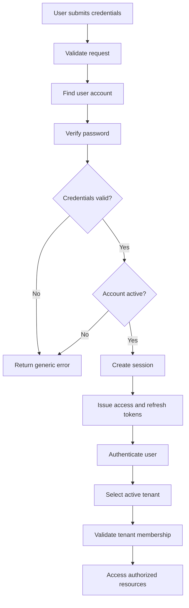

# Authentication and Authorization Architecture

**Project:** CaterFlow  
**Document version:** 0.1  
**Status:** Initial specification  
**Last updated:** November 2026

---

## 1. Purpose

This document defines the authentication and authorization architecture for CaterFlow.

Its purpose is to establish how users authenticate, how sessions are managed, how access is granted, and how permissions are enforced throughout the application.

Authentication and authorization must be implemented as security-critical platform capabilities.

The backend is the authoritative source for identity validation and access control. Frontend restrictions are useful for user experience but must never be considered security boundaries.

## 2. Authentication and Authorization

CaterFlow must distinguish between two concepts.

### 2.1 Authentication

Authentication verifies the identity of a user.

It answers:

- Who is accessing the platform?
- Are their credentials valid?
- Is their account active?
- Is the current session valid?

### 2.2 Authorization

Authorization determines what an authenticated user is allowed to do.

It answers:

- Which tenant can the user access?
- What role does the user have within that tenant?
- Which resources can they access?
- Which operations can they perform?

A successfully authenticated user must not automatically receive access to every tenant or resource.

Authorization must be evaluated independently for each protected operation.

## 3. Authentication Strategy

CaterFlow will initially use an email-and-password authentication mechanism with JWT-based access tokens.

The architecture should support future authentication methods without requiring major changes to the business modules.

Potential future extensions include:

- Google authentication.
- Microsoft authentication.
- Multi-factor authentication.
- Enterprise Single Sign-On (SSO).

These extensions are not part of the initial MVP.

### 3.1 Core Components

The authentication system will include:

- User accounts.
- Password hashing and verification.
- Access tokens.
- Refresh tokens.
- Session management.
- Password recovery.
- Account status management.
- Tenant membership integration.
- Role-based access control.

## 4. User Accounts

A user account represents an individual who can authenticate with CaterFlow.

The user identity is global to the platform and is independent of tenant-specific business data.

### 4.1 User Attributes

The initial user model should include:

| Field | Description |
|---|---|
| id | Unique user identifier |
| email | User's email address |
| password_hash | Secure password hash |
| full_name | User's display name |
| is_active | Whether the account is active |
| email_verified_at | Email verification timestamp |
| last_login_at | Last successful login |
| created_at | Account creation timestamp |
| updated_at | Last update timestamp |

Additional fields may be introduced when required.

### 4.2 Email Address

Email addresses will initially serve as the user's login identifier.

The system must:

- Normalize email addresses consistently.
- Enforce global uniqueness.
- Validate email format.
- Avoid exposing whether an account exists through password recovery responses.
- Require verification before enabling sensitive account operations, according to the final onboarding policy.

The exact verification requirements must be finalized before public registration is released.

## 5. Password Security

Passwords must never be stored in plaintext.

The backend must use a dedicated password-hashing algorithm designed for password storage.

Recommended algorithms:

- Argon2id (preferred).
- bcrypt (acceptable alternative when properly configured).

Argon2id is the recommended initial choice.

The implementation must use a maintained library rather than implementing hashing algorithms manually.

### 5.1 Password Requirements

The initial password policy should:

- Require a minimum length of 12 characters.
- Allow long passphrases.
- Support password managers.
- Avoid arbitrary periodic password changes.
- Reject commonly compromised passwords when a suitable validation mechanism is available.
- Never truncate passwords silently.

The policy should balance security and usability.

### 5.2 Password Storage

Only the password hash and its associated algorithm parameters may be stored.

Passwords must never appear in:

- Application logs.
- Error messages.
- Audit records.
- Analytics events.
- URLs.
- API responses.

## 6. Login Flow

The login process should follow this sequence:

1. User submits email and password.
2. Backend validates the request.
3. Backend retrieves the user account.
4. Backend verifies the password hash.
5. Backend checks whether the account is active.
6. Backend verifies any required account restrictions.
7. Backend creates an authenticated session.
8. Backend issues an access token and refresh token.
9. Frontend receives the authentication result.
10. User selects an active tenant when necessary.

Invalid credentials must produce a generic authentication error.

The application must not reveal whether the email address exists or whether the password alone was incorrect.

### 6.1 Login Flow Diagram



## 7. JWT Access Tokens

Access tokens will be used to authenticate API requests.

The backend must validate every access token before processing protected operations.

### 7.1 Token Claims

Access tokens should contain only the information necessary for authentication and authorization context.

Recommended claims:

| Claim | Purpose |
|---|---|
| sub | User identifier |
| jti | Unique token identifier |
| iss | Token issuer |
| aud | Intended audience |
| iat | Issued-at timestamp |
| exp | Expiration timestamp |

Tenant-specific roles and permissions should not be treated as permanently authoritative claims because memberships and permissions may change.

The backend must validate the active tenant membership and required permissions when processing tenant-specific requests.

### 7.2 Token Lifetime

Recommended initial configuration:

| Token | Lifetime |
|---|---|
| Access token | 10–15 minutes |
| Refresh token | Up to 30 days, subject to rotation and session policy |

These values should be configurable through secure application settings.

Short-lived access tokens reduce the impact of token exposure.

### 7.3 Token Signing

The application must use a maintained JWT library and a secure signing algorithm.

The selected algorithm and key-management strategy must be documented before production deployment.

Signing secrets or private keys must never be committed to Git or embedded in frontend code.

## 8. Refresh Token Strategy

Refresh tokens allow users to obtain new access tokens without entering their credentials repeatedly.

CaterFlow should use refresh token rotation.

Whenever a refresh token is successfully used:

1. The backend validates the token.
2. The associated session is checked.
3. The current refresh token is invalidated.
4. A new access token is issued.
5. A new refresh token is issued.
6. The token family and session information are updated.

### 8.1 Token Reuse Detection

If an already-invalidated refresh token is reused, the system should treat this as a potential compromise.

The associated token family or session should be revoked according to the session security policy.

### 8.2 Refresh Token Storage

Refresh tokens must be stored securely.

The database should store a cryptographic hash of each refresh token rather than the original token value.

The original refresh token should only be available to the client.

The exact client-side storage mechanism must be finalized alongside the frontend authentication implementation.

## 9. Session Management

Authentication sessions must be represented explicitly in the backend.

A session should contain information such as:

| Field | Description |
|---|---|
| id | Unique session identifier |
| user_id | Associated user |
| refresh_token_hash | Stored refresh token hash |
| token_family_id | Refresh token rotation family |
| created_at | Session creation timestamp |
| last_used_at | Last refresh or activity timestamp |
| expires_at | Session expiration |
| revoked_at | Session revocation timestamp |
| user_agent | Optional client information |
| ip_address | Optional security metadata |

Sensitive information must be handled carefully, especially IP addresses and device metadata.

Retention should follow the platform's security and privacy policies.

### 9.1 Session Revocation

The system must support:

- Logout from the current session.
- Logout from all sessions.
- Revocation of compromised sessions.
- Revocation after password changes when required.
- Revocation after account deactivation.
- Revocation of refresh token families.

Revoked sessions must not be allowed to generate new access tokens.

Short-lived access tokens may remain valid until expiration unless an additional access-token revocation mechanism is implemented.

The system must document this limitation and define how sensitive operations handle recently revoked sessions.

## 10. Logout Flow

Logout must invalidate the current refresh token and revoke the corresponding session.

The frontend must also clear its local authentication state.

If the user chooses to log out from all devices, all active sessions must be revoked.

Logout should be idempotent: repeating the operation must not create inconsistent session states.

## 11. Password Recovery

CaterFlow must provide a secure password recovery mechanism.

The flow should:

1. User submits their email address.
2. Backend returns a generic confirmation response.
3. If the account exists, a recovery token is generated.
4. The token is delivered through the configured email provider.
5. User opens the recovery link.
6. Backend validates the token.
7. User submits a new password.
8. Backend hashes and stores the new password.
9. Recovery token is invalidated.
10. Existing sessions are revoked according to the security policy.

Recovery tokens must:

- Be cryptographically random.
- Have a short expiration period.
- Be single-use.
- Be stored securely, preferably as hashes.
- Never appear in application logs.

A recovery link must not disclose sensitive account information.

## 12. Email Verification

Email verification will help confirm that users control their registered email addresses.

The initial design should support:

- Verification token generation.
- Token expiration.
- Single-use verification.
- Resending verification emails.
- Verification status tracking.

Email verification requirements for account activation and sensitive actions must be finalized before public onboarding.

## 13. Authorization Model (RBAC)

CaterFlow will use Role-Based Access Control (RBAC) within each tenant.

Roles determine which permissions a user receives.

A user may have different roles in different tenants.

### 13.1 Initial Roles

The initial role model should include:

| Role | Description |
|---|---|
| Owner | Primary owner of the company account |
| Administrator | Manages company settings and users |
| Manager | Manages daily business operations |
| Staff | Accesses assigned operational functions |
| Finance | Manages financial operations and reports |
| Viewer | Read-only access to permitted information |

These are initial role definitions, not necessarily immutable system-wide permission sets.

### 13.2 Permissions

Permissions should represent specific operations rather than relying only on frontend pages.

Examples:

| Permission | Description |
|---|---|
| customers.read | View customers |
| customers.create | Create customers |
| customers.update | Update customers |
| customers.delete | Delete customers |
| quotations.read | View quotations |
| quotations.create | Create quotations |
| quotations.approve | Approve quotations |
| events.read | View events |
| events.update | Update events |
| workforce.manage | Manage employees and assignments |
| payments.read | View payments |
| payments.manage | Manage payment records |
| expenses.read | View expenses |
| expenses.manage | Manage expenses |
| reports.read | Access reports |
| users.manage | Manage tenant users |
| settings.manage | Manage company settings |

The permission catalog should evolve as business modules are implemented.

### 13.3 Role-Permission Relationship

The database model should support a relationship between:

- Tenant memberships.
- Roles.
- Permissions.

Recommended structure:

```text
users
  |
  | 1:N
  |
tenant_memberships
  |
  | N:1
  |
roles
  |
  | N:M
  |
permissions
```

The exact database implementation will be detailed in `DATABASE.md`.

### 13.4 Role Assignment

Role assignments must be scoped to a tenant.

An administrator must not assign permissions in another tenant.

The system should protect critical ownership operations, including:

- Transferring tenant ownership.
- Removing the last owner.
- Modifying administrator access.
- Deactivating the account responsible for tenant ownership.

Such operations should require additional authorization and audit logging.

## 14. Tenant Membership Authorization

A user can only access tenant resources when an active membership exists.

The authorization process must validate:

1. User identity.
2. Tenant membership.
3. Membership status.
4. Assigned role.
5. Required permission.
6. Resource ownership.

Tenant membership and account status are independent.

For example:

- A user account may be active while one tenant membership is inactive.
- A user may belong to two tenants with different roles.
- Revoking one membership must not automatically revoke unrelated memberships.

The exact behavior of invitations, pending memberships, and membership removal will be defined during implementation.

## 15. API Security Requirements

All protected API endpoints must enforce authentication and authorization.

The backend must:

- Validate JWT signatures.
- Validate expiration.
- Validate issuer and audience.
- Reject malformed tokens.
- Reject revoked sessions when session validation is required.
- Validate tenant membership.
- Enforce permission checks.
- Prevent unauthorized resource access.
- Avoid exposing sensitive authentication details in errors.

Sensitive operations should receive additional authorization checks where appropriate.

## 16. Frontend Authentication Responsibilities

The frontend is responsible for providing a secure and understandable authentication experience.

Expected features:

- Login page.
- Logout action.
- Password recovery page.
- Password reset page.
- Email verification flow.
- Tenant selection.
- Session expiration handling.
- Unauthorized access handling.
- Permission-aware navigation.

Frontend route protection improves usability but does not replace backend authorization.

The backend must remain secure even if a user modifies frontend code or sends API requests directly.

### 16.1 Token Storage

The final token storage approach must be selected before implementation.

The preferred direction is:

- Access token kept in memory where practical.
- Refresh token protected through an appropriately configured `HttpOnly`, `Secure`, `SameSite` cookie when using a compatible browser architecture.
- HTTPS required in production.
- CSRF protections applied when cookie-based authentication requires them.

Persistent browser storage such as `localStorage` should not be used for long-lived refresh tokens because JavaScript-accessible storage increases exposure in an XSS incident.

Cookie domain, CORS, CSRF, and frontend/backend deployment arrangements must be considered together.

## 17. Brute Force and Abuse Protection

Authentication endpoints must include abuse protection.

Recommended controls:

- Rate limiting for login attempts.
- Rate limiting for password recovery.
- Progressive delays for repeated failed attempts.
- Monitoring of suspicious authentication activity.
- Protection against automated credential-stuffing attempts.
- Generic authentication error responses.

Account lockout policies must be designed carefully to avoid allowing attackers to intentionally deny service to legitimate users.

## 18. Audit Logging

Security-relevant authentication events must be recorded.

Examples:

- Successful login.
- Failed login attempts.
- Logout.
- Password change.
- Password recovery.
- Email verification.
- Session revocation.
- Account deactivation.
- Role changes.
- Membership changes.
- Tenant ownership transfer.

Audit records should include relevant identifiers and timestamps without storing passwords, raw tokens, or other authentication secrets.

Audit access must be restricted according to the security model.

## 19. Testing Requirements

Authentication and authorization must have dedicated automated tests.

### 19.1 Authentication Tests

- Valid login succeeds.
- Invalid credentials are rejected.
- Inactive accounts cannot authenticate.
- Expired access tokens are rejected.
- Invalid signatures are rejected.
- Refresh token rotation works correctly.
- Reused refresh tokens trigger the defined security response.
- Revoked sessions cannot refresh.
- Password recovery tokens are single-use.
- Passwords are never returned in API responses.

### 19.2 Authorization Tests

- Users without membership cannot access tenant resources.
- Inactive memberships cannot access tenant resources.
- Users cannot execute operations without the required permission.
- Users can have different roles across tenants.
- Tenant administrators cannot manage users in another tenant.
- Ownership restrictions are enforced.
- Direct API requests cannot bypass frontend permission restrictions.

### 19.3 Security Tests

- Login rate limiting works.
- Recovery responses do not reveal account existence.
- Sensitive tokens are not logged.
- Cookie security attributes are configured correctly.
- CSRF protections work when required.
- Session revocation behaves consistently.

## 20. Open Decisions

The following decisions must be finalized before production implementation:

| Decision | Status |
|---|---|
| JWT signing algorithm and key management | Open |
| Access and refresh token lifetimes | Proposed |
| Frontend token storage implementation | Open |
| Refresh token rotation and reuse response | Recommended |
| Email provider | Open |
| Email verification activation policy | Open |
| Password recovery token lifetime | Open |
| Final role-permission matrix | Open |
| Custom tenant roles | Future consideration |
| Multi-factor authentication | Future consideration |
| Google/Microsoft SSO | Future consideration |
| Session management interface | Open |
| Account deletion and retention behavior | Open |

## 21. Architectural Principles

The following principles are mandatory:

1. Passwords must never be stored in plaintext.
2. Authentication and authorization must remain separate concerns.
3. JWT validation must occur on the backend.
4. Access tokens must have limited lifetimes.
5. Refresh tokens must support rotation and revocation.
6. Tenant membership must be validated for every tenant-specific operation.
7. Permissions must be enforced by the backend.
8. Frontend access restrictions must never be considered sufficient security.
9. Authentication secrets must never be exposed in logs.
10. Critical authentication and authorization events must be auditable.
11. Session and token handling must be designed to minimize the impact of credential theft.
12. Security requirements must be covered by automated tests.

---

**End of document.**