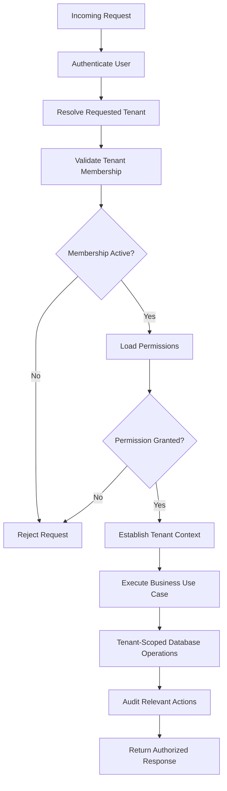

# Multi-Tenancy Architecture

**Project:** CaterFlow  
**Document version:** 0.1  
**Status:** Initial specification  
**Last updated:** November 2026

---

## 1. Purpose

This document defines how CaterFlow will support multiple catering companies (tenants) within a single SaaS platform.

The main objective is to ensure that each company can independently manage its customers, employees, quotations, events, financial records, settings, and documents without accessing information belonging to another company.

Multi-tenancy must be implemented as a fundamental architectural requirement, not as an additional feature.

Security and data isolation must be enforced by the backend and database layers.

## 2. Multi-Tenancy Strategy

CaterFlow will initially use a **shared database and shared schema architecture**.

All tenants will use the same PostgreSQL database and the same set of tables.

Tenant-owned records will include a `tenant_id` column identifying the company that owns the data.

Conceptually:

- One application.
- One PostgreSQL database.
- One shared database schema.
- Multiple tenants.
- Strict logical data isolation through `tenant_id`.

This approach reduces infrastructure complexity and operational costs while allowing the platform to scale as the number of companies increases.

### 2.1 Why Shared Schema?

The shared-schema strategy was selected because:

- It simplifies database management and migrations.
- It reduces infrastructure costs.
- It allows new features to become available to all tenants.
- It supports centralized maintenance.
- It simplifies platform-wide reporting and monitoring.
- It is suitable for the initial SaaS business model.

Separate databases or schemas per tenant are not part of the MVP.

They may be considered in the future if specific customers require stronger infrastructure isolation, regulatory requirements, or dedicated environments.

## 3. Core Concepts

The system must distinguish between users, tenants, and tenant memberships.

### 3.1 Tenant

A tenant represents an independent catering company registered on CaterFlow.

Each tenant has its own:

- Company profile.
- Logo and branding.
- Business contact information.
- Tax identification information.
- Employees and collaborators.
- Customers.
- Catalog and pricing configuration.
- Quotations and events.
- Payments and expenses.
- Business settings.
- Language and timezone preferences.

A tenant is the primary ownership boundary for business data.

### 3.2 User

A user represents an individual with credentials to access CaterFlow.

Users are platform-level identities and are not automatically associated with a specific company.

A user must have an active membership in a tenant to access its business data.

### 3.3 Tenant Membership

A tenant membership establishes the relationship between a user and a company.

It determines:

- Which tenant the user can access.
- The user's role within that tenant.
- Whether the membership is active.
- Which permissions are available.

**Recommended approach:** The data model should support one user belonging to multiple tenants, even if the first version of the interface primarily supports one company per user.

This allows future scenarios such as consultants, accountants, external managers, or users working for multiple catering companies.

A user must explicitly select an active tenant when multiple memberships are available.

## 4. Data Ownership

Every business record must have a clearly defined owner.

### 4.1 Tenant-Owned Data

The following entities must belong to a tenant:

| Entity | Tenant ownership |
|---|---|
| Customers | Required |
| Employees | Required |
| Employee assignments | Required |
| Catalog items | Required |
| Menus | Required |
| Pricing rules | Required |
| Quotations | Required |
| Quotation versions | Required |
| Events | Required |
| Payment schedules | Required |
| Payments | Required |
| Expenses | Required |
| Uploaded documents | Required |
| Company settings | Required |
| Audit records | Required |

All tenant-owned records must include a non-null `tenant_id`.

### 4.2 Platform-Level Data

Some information may be shared across the platform rather than owned by an individual tenant.

Examples:

- Supported languages.
- Application-wide configuration.
- Platform feature definitions.
- Subscription plan definitions.
- Public system metadata.

Platform-level records must not be confused with tenant-owned business records.

A tenant must not be able to modify global platform configuration through ordinary tenant permissions.

## 5. Tenant Context Resolution

Every authenticated request that accesses tenant-owned resources must execute within a validated tenant context.

The backend must never trust a tenant identifier simply because it was supplied by the frontend.

A tenant context must be established using:

1. The authenticated user's identity.
2. The tenant selected for the current operation.
3. The user's membership in that tenant.
4. The membership's active status.
5. The user's permissions for the requested operation.

The backend must reject requests when the user does not have an active membership in the selected tenant.

### 5.1 Tenant Selection

The frontend will need a consistent mechanism for selecting the active tenant.

The exact API contract for transmitting the selected tenant will be defined during implementation.

Regardless of whether the identifier is provided through a request header, route, or another mechanism, the backend must independently validate the user's membership.

The tenant identifier is a selection parameter, not proof of authorization.

### 5.2 Request Lifecycle

Every request involving tenant-owned data should follow this sequence:

1. Authenticate the user.
2. Identify the requested tenant.
3. Validate the user's membership.
4. Resolve the active tenant context.
5. Check the required permissions.
6. Execute the application use case within the tenant context.
7. Restrict all database operations to that tenant.
8. Record relevant audit information.
9. Return only authorized data.

If any validation fails, the request must be rejected before business data is accessed.

### 5.3 Request Context Diagram



## 6. Database Isolation Requirements

Tenant isolation must be enforced consistently at the database access layer.

### 6.1 Tenant ID Requirements

Every tenant-owned table must contain:

- `id`: the record identifier.
- `tenant_id`: the owning tenant identifier.
- Appropriate timestamps and business fields.

The `tenant_id` column must be non-null for tenant-owned records.

The application must never create a tenant-owned record without a validated tenant context.

### 6.2 Tenant-Scoped Queries

All queries involving tenant-owned records must include the active tenant scope.

For example, retrieving a customer must not consist only of searching by its ID.

The operation must also validate that the customer belongs to the active tenant.

Conceptually:

```sql
SELECT *
FROM customers
WHERE id = :customer_id
AND tenant_id = :current_tenant_id;
```

The same principle applies to:

- Updates.
- Deletes.
- Relationships.
- Reports.
- Aggregations.
- Exports.
- Background operations.

Tenant filtering must not depend on individual developers remembering to add conditions manually in every endpoint.

Repository and service patterns should centralize these protections.

### 6.3 Composite Unique Constraints

Business identifiers that must be unique within a company should use tenant-scoped constraints.

For example:

```sql
UNIQUE (tenant_id, email)
```

This allows different companies to register customers with the same email address when appropriate, while preventing duplicate records within the same tenant according to the chosen business rules.

Global uniqueness should only be used when there is a specific platform-level requirement.

### 6.4 Tenant-Scoped Foreign Keys

Foreign keys must prevent relationships between records belonging to different tenants.

For example, an event must not reference a customer owned by another company.

A recommended database pattern is:

```sql
UNIQUE (tenant_id, id)
```

on the referenced table, combined with a composite foreign key:

```sql
FOREIGN KEY (tenant_id, customer_id)
REFERENCES customers (tenant_id, id)
```

This adds database-level protection against cross-tenant relationships, even if an application-level validation is accidentally missed.

The same principle should be applied to other tenant-owned relationships whenever appropriate.

## 7. Row-Level Security (RLS)

PostgreSQL Row-Level Security may provide an additional layer of protection.

RLS policies can restrict database operations according to the tenant context established for the current transaction.

However, RLS must not replace application-level authorization.

The recommended approach is:

- Keep tenant authorization in the backend.
- Apply tenant filtering through the data access layer.
- Evaluate PostgreSQL RLS as defense in depth.
- Document the decision in an Architecture Decision Record before implementation.

If RLS is adopted, the tenant context should be established transaction-locally, for example using `SET LOCAL`, rather than relying on persistent session state.

This is particularly important when using connection pools, because database connections may be reused across different requests.

The implementation must guarantee that tenant context cannot leak between transactions.

**Status:** RLS adoption remains an open technical decision.

## 8. Application Layer Responsibilities

Tenant isolation must be applied consistently across all backend modules.

Each module must receive or access the validated tenant context through a controlled application mechanism.

The following rules apply:

- API endpoints must not implement independent tenant authorization logic.
- Application services must receive the validated tenant context.
- Repositories must restrict access to the active tenant.
- Database relationships must preserve tenant ownership.
- Business operations must not accept arbitrary tenant ownership from untrusted payloads.
- Background tasks must receive an explicit tenant context.

A tenant identifier provided in a creation payload must never override the authenticated request's tenant context.

## 9. Background Jobs and Asynchronous Operations

Background jobs must preserve tenant isolation.

Examples include:

- PDF generation.
- Email delivery.
- Scheduled payment reminders.
- Financial reports.
- Document processing.
- Data exports.

Every tenant-specific job must carry sufficient context to identify:

- The tenant.
- The initiating user or system actor, when applicable.
- The requested operation.
- The relevant resource identifiers.

Before accessing tenant-owned data, the job must validate that its context is valid.

Jobs must not rely on a previously active web request or an implicit global tenant variable.

## 10. File Storage Isolation

Uploaded files must also respect tenant ownership.

Examples:

- Company logos.
- Quotation PDFs.
- Event documents.
- Receipts.
- Expense attachments.

The storage abstraction must use tenant-aware paths or object keys.

Conceptual structure:

```text
tenants/
    {tenant_id}/
        branding/
        quotations/
        events/
        expenses/
        documents/
```

The actual storage provider and path strategy will be defined in `STORAGE.md`.

File access must always be authorized by the backend.

Knowing or guessing a file URL or storage key must not grant access to the file.

## 11. Cache and Reporting Isolation

Caches and reporting mechanisms must preserve tenant boundaries.

### 11.1 Cache Keys

Tenant-specific cache keys must include the tenant identifier.

Conceptual example:

```text
tenant:{tenant_id}:dashboard:summary
```

This prevents one company's cached information from being returned to another company.

### 11.2 Reports and Aggregations

All tenant-level dashboards, financial reports, exports, and analytics must operate within the validated tenant context.

Platform-level analytics may aggregate information across tenants only through explicitly authorized internal processes.

Tenant users must never receive cross-tenant aggregated information that exposes another company's business data.

## 12. User Roles and Administrative Access

Tenant administration and platform administration must be treated as separate security domains.

### 12.1 Tenant Administrator

A tenant administrator can manage their own company's configuration and users according to the permission model.

They cannot access another tenant's information.

### 12.2 Tenant Staff

Employees and collaborators receive permissions according to their assigned roles.

Their access must remain limited to their tenant and authorized operations.

### 12.3 Platform Administrator

A platform administrator is responsible for operating CaterFlow itself.

Platform administration must not automatically grant unrestricted access to tenant business data.

Any exceptional support access must follow a controlled and auditable process.

The exact support-access workflow remains an open decision.

## 13. Tenant Lifecycle

Tenants should have a lifecycle independent of individual user accounts.

The initial lifecycle may include:

| Status | Description |
|---|---|
| Active | Tenant can use the platform normally |
| Suspended | Access to selected platform functions is restricted |
| Archived | Tenant is no longer operational but its records are retained according to applicable policies |

The exact behavior of suspended and archived tenants must be defined before implementation.

Tenant suspension must not automatically delete financial records, audit history, quotations, or event data.

Tenant deletion must follow a documented process that considers legal retention obligations, contractual requirements, backups, and privacy obligations.

## 14. Tenant Registration and Initialization

Tenant creation must be performed through a controlled onboarding process.

The initial process should:

1. Create the tenant record.
2. Create or associate the initial owner user.
3. Create the initial tenant membership.
4. Assign the initial administrator role.
5. Initialize default tenant settings.
6. Initialize supported language and timezone preferences.
7. Initialize the default currency as EUR.
8. Record the tenant creation event.

These operations should be performed within a database transaction whenever possible.

If any required step fails, the system must avoid leaving a partially initialized tenant.

The initial tenant settings should use:

- Default language: Spanish.
- Default timezone: `Europe/Madrid`.
- Default currency: EUR.

These values are defaults and must remain configurable by each tenant.

## 15. Performance and Scalability

The shared-schema strategy requires careful indexing and query design.

Recommended practices:

- Index `tenant_id` on tenant-owned tables.
- Use composite indexes for frequently queried tenant-specific fields.
- Analyze query plans for large tenant datasets.
- Avoid unnecessary full-table scans.
- Apply pagination to large collections.
- Use tenant-scoped aggregation queries.
- Monitor unusually large tenants and expensive operations.

Example index:

```sql
CREATE INDEX idx_events_tenant_date
ON events (tenant_id, event_date);
```

The system should be designed so that increasing the number of tenants does not require changing the fundamental isolation model.

## 16. Security Threats and Mitigations

| Threat | Mitigation |
|---|---|
| User accesses another tenant's record by changing an ID | Tenant-scoped queries and authorization |
| User submits another tenant's ID in a payload | Ignore untrusted ownership fields and use validated context |
| Cross-tenant foreign key relationship | Composite tenant-scoped foreign keys |
| Missing tenant filter in a query | Centralized repository protections and integration tests |
| Tenant context leaks through connection pooling | Transaction-local database context |
| Cache returns another tenant's data | Tenant-aware cache keys |
| File URL exposes another tenant's document | Backend authorization and tenant-aware storage |
| Background job processes the wrong tenant | Explicit tenant context and validation |
| Platform support user accesses business data without authorization | Restricted, audited support access |

## 17. Testing Requirements

Tenant isolation is a critical security requirement and must have dedicated automated tests.

The test suite must verify at least:

### 17.1 Data Access

- Tenant A cannot retrieve Tenant B's customers.
- Tenant A cannot modify Tenant B's events.
- Tenant A cannot delete Tenant B's quotations.
- Tenant A cannot access Tenant B's financial records.
- Tenant A cannot access Tenant B's documents.

### 17.2 Relationships

- An event cannot reference a customer from another tenant.
- A quotation cannot reference catalog items from another tenant.
- An employee assignment cannot reference an employee from another tenant.
- Payments and expenses cannot be associated with records from another tenant.

### 17.3 Authorization

- Users without membership cannot access a tenant.
- Inactive memberships cannot access tenant resources.
- Users cannot perform operations beyond their permissions.
- Changing the tenant identifier in a request cannot bypass authorization.

### 17.4 Infrastructure

- Cache entries remain tenant-specific.
- Background jobs preserve tenant context.
- Database connections do not retain tenant context between transactions.
- File access is restricted to authorized tenant members.

Tenant isolation tests must be included in the continuous integration pipeline.

## 18. Migration and Future Considerations

The shared-schema architecture is the initial strategy for CaterFlow.

Future alternatives may include:

- Dedicated database instances for selected tenants.
- Separate schemas for selected tenants.
- Dedicated infrastructure for enterprise customers.
- Region-specific data hosting, if required.

These alternatives must only be introduced when justified by business, regulatory, contractual, or operational requirements.

The application should avoid unnecessary dependencies on the shared-schema implementation so that future migrations remain technically possible.

However, the MVP must prioritize a secure and maintainable shared-schema implementation rather than prematurely supporting multiple isolation strategies.

## 19. Open Decisions

The following decisions must be finalized before or during implementation:

| Decision | Status |
|---|---|
| Support users belonging to multiple tenants | Recommended |
| Tenant selection mechanism in the API | Open |
| PostgreSQL RLS adoption | Open |
| Platform support access workflow | Open |
| Suspended tenant behavior | Open |
| Tenant deletion and retention workflow | Open |
| User invitation and membership lifecycle | Open |
| Tenant-specific subscription enforcement | Future consideration |

These decisions should be documented through Architecture Decision Records when finalized.

## 20. Architectural Principles

The following principles are mandatory:

1. Every tenant-owned record must have a valid tenant owner.
2. Tenant context must be validated by the backend.
3. Tenant ownership must never be trusted from frontend input.
4. All tenant-specific database operations must be scoped.
5. Cross-tenant relationships must be prevented.
6. Files, caches, background jobs, and reports must preserve tenant isolation.
7. Platform administration must remain separate from tenant administration.
8. Financial and audit records must be preserved according to applicable retention rules.
9. Tenant isolation must be verified through automated tests.
10. Security must be enforced at multiple layers rather than depending on a single mechanism.

---

**End of document.**