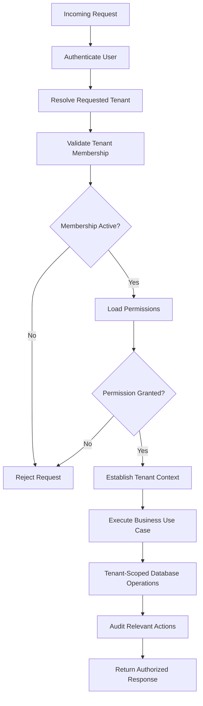

# Multi-Tenancy Architecture

**Project:** CaterFlow  
**Document version:** 0.1  
**Status:** Initial specification  
**Last updated:** November 2026

---

## 1. Purpose

This document defines how CaterFlow will support multiple catering companies (tenants) within a single SaaS platform.

The main objective is to ensure that each company can independently manage its customers, employees, quotations, events, financial records, settings, and documents without accessing information belonging to another company.

Multi-tenancy must be implemented as a fundamental architectural requirement, not as an additional feature.

Security and data isolation must be enforced by the backend and database layers.

## 2. Multi-Tenancy Strategy

CaterFlow will initially use a **shared database and shared schema architecture**.

All tenants will use the same PostgreSQL database and the same set of tables.

Tenant-owned records will include a `tenant_id` column identifying the company that owns the data.

Conceptually:

- One application.
- One PostgreSQL database.
- One shared database schema.
- Multiple tenants.
- Strict logical data isolation through `tenant_id`.

This approach reduces infrastructure complexity and operational costs while allowing the platform to scale as the number of companies increases.

### 2.1 Why Shared Schema?

The shared-schema strategy was selected because:

- It simplifies database management and migrations.
- It reduces infrastructure costs.
- It allows new features to become available to all tenants.
- It supports centralized maintenance.
- It simplifies platform-wide reporting and monitoring.
- It is suitable for the initial SaaS business model.

Separate databases or schemas per tenant are not part of the MVP.

They may be considered in the future if specific customers require stronger infrastructure isolation, regulatory requirements, or dedicated environments.


## 3. Core Concepts

The system distinguishes between Users, Tenants, Memberships, and Platform Administrators.

### 3.1 Tenant

A Tenant represents an independent catering company registered on CaterFlow.

Each tenant owns its business data, including:

- Clients.
- Employees and workforce records.
- Products and services.
- Product categories.
- Quotes and quote items.
- Events.
- Future payment and expense records.
- Company-specific configuration when implemented.

A tenant is the primary ownership boundary for business data.

### 3.2 User

A User represents a global identity within the CaterFlow platform.

Users are independent of tenant-specific business data.

A global user account contains one email address and one password. The same credentials are used when accessing different tenant memberships.

A user account may be associated with multiple tenants.

### 3.3 Tenant Membership

A Membership establishes the relationship between a global User and a Tenant.

The membership provides the basis for tenant access and tenant-specific role assignments.

A user may have multiple memberships, each associated with a different tenant.

The current implementation does not use an independent active/inactive flag on Membership. The existence of the membership association determines whether the user is associated with that tenant.

Removing a membership does not delete the global user or unrelated memberships.

### 3.4 Platform Administrator

A Platform Administrator is a global administrative privilege associated with a User.

Platform administration is independent of tenant membership.

A Platform Administrator may:

- Manage tenant accounts.
- Create and manage global user accounts.
- Assign and remove tenant memberships.
- Grant or revoke Platform Administrator privileges.
- Activate and deactivate global users.
- Suspend and reactivate tenants.

Platform Administrator privileges do not automatically grant access to tenant business data.

A Platform Administrator must also have a valid tenant membership to access a tenant's operational resources.

## 4. Data Ownership

Every business record must have a clearly defined owner.

### 4.1 Tenant-Owned Data

The following entities must belong to a tenant:

| Entity | Tenant ownership |
|---|---|
| Customers | Required |
| Employees | Required |
| Employee assignments | Required |
| Catalog items | Required |
| Menus | Required |
| Pricing rules | Required |
| Quotations | Required |
| Quotation versions | Required |
| Events | Required |
| Payment schedules | Required |
| Payments | Required |
| Expenses | Required |
| Uploaded documents | Required |
| Company settings | Required |
| Audit records | Required |

All tenant-owned records must include a non-null `tenant_id`.


### 4.2 Platform-Level Data

The following data belongs to the platform rather than to an individual tenant:

| Entity | Ownership |
|---|---|
| Users | Platform-level |
| Tenants | Platform-level |
| Platform Administrators | Platform-level |
| Permissions | Platform-level definitions |
| Refresh tokens | User-associated platform records |

These records support platform authentication, tenant administration, global user management, and authorization.

Memberships, roles, membership-role assignments, and role-permission assignments remain tenant-scoped according to their respective models.

Platform-level access must not bypass tenant authorization or tenant data isolation.

## 5. Tenant Context Resolution

Every authenticated request that accesses tenant-owned resources must execute within a validated tenant context.

The backend must never trust a tenant identifier simply because it was supplied by the frontend.

A tenant context must be established using:

1. The authenticated user's identity.
2. The tenant selected for the current operation.
3. The user's membership in that tenant.
4. The membership's active status.
5. The user's permissions for the requested operation.

The backend must reject requests when the user does not have an active membership in the selected tenant.

### 5.1 Tenant Selection

The frontend will need a consistent mechanism for selecting the active tenant.

The exact API contract for transmitting the selected tenant will be defined during implementation.

Regardless of whether the identifier is provided through a request header, route, or another mechanism, the backend must independently validate the user's membership.

The tenant identifier is a selection parameter, not proof of authorization.

### 5.2 Request Lifecycle

Every request involving tenant-owned data should follow this sequence:

1. Authenticate the user.
2. Identify the requested tenant.
3. Validate the user's membership.
4. Resolve the active tenant context.
5. Check the required permissions.
6. Execute the application use case within the tenant context.
7. Restrict all database operations to that tenant.
8. Record relevant audit information.
9. Return only authorized data.

If any validation fails, the request must be rejected before business data is accessed.

### 5.3 Request Context Diagram



## 6. Database Isolation Requirements

Tenant isolation must be enforced consistently at the database access layer.

### 6.1 Tenant ID Requirements

Every tenant-owned table must contain:

- `id`: the record identifier.
- `tenant_id`: the owning tenant identifier.
- Appropriate timestamps and business fields.

The `tenant_id` column must be non-null for tenant-owned records.

The application must never create a tenant-owned record without a validated tenant context.

### 6.2 Tenant-Scoped Queries

All queries involving tenant-owned records must include the active tenant scope.

For example, retrieving a customer must not consist only of searching by its ID.

The operation must also validate that the customer belongs to the active tenant.

Conceptually:

```sql
SELECT *
FROM customers
WHERE id = :customer_id
AND tenant_id = :current_tenant_id;
```

The same principle applies to:

- Updates.
- Deletes.
- Relationships.
- Reports.
- Aggregations.
- Exports.
- Background operations.

Tenant filtering must not depend on individual developers remembering to add conditions manually in every endpoint.

Repository and service patterns should centralize these protections.

### 6.3 Composite Unique Constraints

Business identifiers that must be unique within a company should use tenant-scoped constraints.

For example:

```sql
UNIQUE (tenant_id, email)
```

This allows different companies to register customers with the same email address when appropriate, while preventing duplicate records within the same tenant according to the chosen business rules.

Global uniqueness should only be used when there is a specific platform-level requirement.

### 6.4 Tenant-Scoped Foreign Keys

Foreign keys must prevent relationships between records belonging to different tenants.

For example, an event must not reference a customer owned by another company.

A recommended database pattern is:

```sql
UNIQUE (tenant_id, id)
```

on the referenced table, combined with a composite foreign key:

```sql
FOREIGN KEY (tenant_id, customer_id)
REFERENCES customers (tenant_id, id)
```

This adds database-level protection against cross-tenant relationships, even if an application-level validation is accidentally missed.

The same principle should be applied to other tenant-owned relationships whenever appropriate.

## 7. Row-Level Security (RLS)

PostgreSQL Row-Level Security may provide an additional layer of protection.

RLS policies can restrict database operations according to the tenant context established for the current transaction.

However, RLS must not replace application-level authorization.

The recommended approach is:

- Keep tenant authorization in the backend.
- Apply tenant filtering through the data access layer.
- Evaluate PostgreSQL RLS as defense in depth.
- Document the decision in an Architecture Decision Record before implementation.

If RLS is adopted, the tenant context should be established transaction-locally, for example using `SET LOCAL`, rather than relying on persistent session state.

This is particularly important when using connection pools, because database connections may be reused across different requests.

The implementation must guarantee that tenant context cannot leak between transactions.

**Status:** RLS adoption remains an open technical decision.

## 8. Application Layer Responsibilities

Tenant isolation must be applied consistently across all backend modules.

Each module must receive or access the validated tenant context through a controlled application mechanism.

The following rules apply:

- API endpoints must not implement independent tenant authorization logic.
- Application services must receive the validated tenant context.
- Repositories must restrict access to the active tenant.
- Database relationships must preserve tenant ownership.
- Business operations must not accept arbitrary tenant ownership from untrusted payloads.
- Background tasks must receive an explicit tenant context.

A tenant identifier provided in a creation payload must never override the authenticated request's tenant context.

## 9. Background Jobs and Asynchronous Operations

Background jobs must preserve tenant isolation.

Examples include:

- PDF generation.
- Email delivery.
- Scheduled payment reminders.
- Financial reports.
- Document processing.
- Data exports.

Every tenant-specific job must carry sufficient context to identify:

- The tenant.
- The initiating user or system actor, when applicable.
- The requested operation.
- The relevant resource identifiers.

Before accessing tenant-owned data, the job must validate that its context is valid.

Jobs must not rely on a previously active web request or an implicit global tenant variable.

## 10. File Storage Isolation

Uploaded files must also respect tenant ownership.

Examples:

- Company logos.
- Quotation PDFs.
- Event documents.
- Receipts.
- Expense attachments.

The storage abstraction must use tenant-aware paths or object keys.

Conceptual structure:

```text
tenants/
    {tenant_id}/
        branding/
        quotations/
        events/
        expenses/
        documents/
```

The actual storage provider and path strategy will be defined in `STORAGE.md`.

File access must always be authorized by the backend.

Knowing or guessing a file URL or storage key must not grant access to the file.

## 11. Cache and Reporting Isolation

Caches and reporting mechanisms must preserve tenant boundaries.

### 11.1 Cache Keys

Tenant-specific cache keys must include the tenant identifier.

Conceptual example:

```text
tenant:{tenant_id}:dashboard:summary
```

This prevents one company's cached information from being returned to another company.

### 11.2 Reports and Aggregations

All tenant-level dashboards, financial reports, exports, and analytics must operate within the validated tenant context.

Platform-level analytics may aggregate information across tenants only through explicitly authorized internal processes.

Tenant users must never receive cross-tenant aggregated information that exposes another company's business data.


## 12. User Roles and Administrative Access

CaterFlow separates platform-level administration from tenant-level administration.

These are distinct authorization domains and must not be treated as interchangeable roles.

### 12.1 Tenant Administrator

A tenant administrator manages users, roles, permissions, and company operations within their own tenant, according to the permissions assigned to them.

Tenant administrators:

- Can manage authorized users within their tenant.
- Can assign tenant roles where permitted.
- Can manage tenant-specific business information.
- Cannot access another tenant's data.
- Cannot modify global user identity information.
- Cannot manage memberships belonging to other tenants.
- Cannot grant or revoke Platform Administrator privileges.

All operations must be validated against the active tenant context and required permission codes.

### 12.2 Tenant Staff

Employees and collaborators receive access according to their assigned tenant roles and permissions.

Their access remains limited to the tenant and operations for which they are authorized.

### 12.3 Platform Administrator

A Platform Administrator operates the CaterFlow SaaS platform itself.

Platform administration includes:

- Tenant creation and management.
- Tenant suspension and reactivation.
- Global user creation and management.
- Global user activation and deactivation.
- Tenant membership assignment and removal.
- Platform Administrator privilege management.

Platform Administrators are authenticated through a separate platform login flow and protected by platform-specific backend authorization dependencies.

Platform administration does not automatically grant access to tenant business information.

A Platform Administrator must have an explicit tenant membership to access that tenant's operational resources.

### 12.4 Global User and Membership Lifecycle

A global User can belong to multiple tenants through Membership records.

The user's email and password are global and shared across all memberships.

The following rules apply:

- A non-Platform Administrator must have at least one tenant membership.
- A Platform Administrator may exist without tenant memberships.
- A Platform Administrator may also have tenant memberships.
- Removing one membership does not remove other memberships.
- Revoking Platform Administrator privileges does not remove tenant memberships.
- Deactivating a User blocks authentication globally and revokes refresh tokens.
- Tenant administrators cannot modify global identity or memberships outside their own tenant.

### 12.5 Ownership and Administrative Safeguards

The backend protects critical access operations.

It must prevent:

- Removing the last active Owner from a tenant.
- Deactivating the last active Owner of a tenant.
- Deactivating the last active Platform Administrator.
- Removing the current Platform Administrator's own platform access through protected self-management operations.

These rules must be enforced by backend services and covered by automated tests.


## 13. Tenant Lifecycle

Tenants have a lifecycle independent of global user accounts and memberships.

The current implementation supports the following operational states:

| Status | Description | Implementation |
|---|---|---|
| Active | Tenant can use the platform normally | Implemented |
| Suspended | Tenant access is blocked | Implemented |
| Archived | Tenant is retained but no longer operational | Future capability |

Platform Administrators can create tenants, retrieve and update tenant information, suspend tenants, and reactivate suspended tenants.

Suspension prevents normal tenant authentication and protected tenant access.

Tenant suspension does not:

- Delete tenant data.
- Delete global users.
- Remove tenant memberships.
- Delete tenant roles or permissions.
- Automatically deactivate associated global users.

Tenant archival and permanent deletion require separate retention, legal, and data lifecycle policies and are not part of the current implementation.

## 14. Tenant Registration and Initialization

Tenant creation must be performed through a controlled onboarding process.

The initial process should:

1. Create the tenant record.
2. Create or associate the initial owner user.
3. Create the initial tenant membership.
4. Assign the initial administrator role.
5. Initialize default tenant settings.
6. Initialize supported language and timezone preferences.
7. Initialize the default currency as EUR.
8. Record the tenant creation event.

These operations should be performed within a database transaction whenever possible.

If any required step fails, the system must avoid leaving a partially initialized tenant.

The initial tenant settings should use:

- Default language: Spanish.
- Default timezone: `Europe/Madrid`.
- Default currency: EUR.

These values are defaults and must remain configurable by each tenant.

## 15. Performance and Scalability

The shared-schema strategy requires careful indexing and query design.

Recommended practices:

- Index `tenant_id` on tenant-owned tables.
- Use composite indexes for frequently queried tenant-specific fields.
- Analyze query plans for large tenant datasets.
- Avoid unnecessary full-table scans.
- Apply pagination to large collections.
- Use tenant-scoped aggregation queries.
- Monitor unusually large tenants and expensive operations.

Example index:

```sql
CREATE INDEX idx_events_tenant_date
ON events (tenant_id, event_date);
```

The system should be designed so that increasing the number of tenants does not require changing the fundamental isolation model.

## 16. Security Threats and Mitigations

| Threat | Mitigation |
|---|---|
| User accesses another tenant's record by changing an ID | Tenant-scoped queries and authorization |
| User submits another tenant's ID in a payload | Ignore untrusted ownership fields and use validated context |
| Cross-tenant foreign key relationship | Composite tenant-scoped foreign keys |
| Missing tenant filter in a query | Centralized repository protections and integration tests |
| Tenant context leaks through connection pooling | Transaction-local database context |
| Cache returns another tenant's data | Tenant-aware cache keys |
| File URL exposes another tenant's document | Backend authorization and tenant-aware storage |
| Background job processes the wrong tenant | Explicit tenant context and validation |
| Platform support user accesses business data without authorization | Restricted, audited support access |

## 17. Testing Requirements

Tenant isolation is a critical security requirement and must have dedicated automated tests.

The test suite must verify at least:

### 17.1 Data Access

- Tenant A cannot retrieve Tenant B's customers.
- Tenant A cannot modify Tenant B's events.
- Tenant A cannot delete Tenant B's quotations.
- Tenant A cannot access Tenant B's financial records.
- Tenant A cannot access Tenant B's documents.

### 17.2 Relationships

- An event cannot reference a customer from another tenant.
- A quotation cannot reference catalog items from another tenant.
- An employee assignment cannot reference an employee from another tenant.
- Payments and expenses cannot be associated with records from another tenant.

### 17.3 Authorization

- Users without membership cannot access a tenant.
- Inactive memberships cannot access tenant resources.
- Users cannot perform operations beyond their permissions.
- Changing the tenant identifier in a request cannot bypass authorization.

### 17.4 Infrastructure

- Cache entries remain tenant-specific.
- Background jobs preserve tenant context.
- Database connections do not retain tenant context between transactions.
- File access is restricted to authorized tenant members.

Tenant isolation tests must be included in the continuous integration pipeline.

## 18. Migration and Future Considerations

The shared-schema architecture is the initial strategy for CaterFlow.

Future alternatives may include:

- Dedicated database instances for selected tenants.
- Separate schemas for selected tenants.
- Dedicated infrastructure for enterprise customers.
- Region-specific data hosting, if required.

These alternatives must only be introduced when justified by business, regulatory, contractual, or operational requirements.

The application should avoid unnecessary dependencies on the shared-schema implementation so that future migrations remain technically possible.

However, the MVP must prioritize a secure and maintainable shared-schema implementation rather than prematurely supporting multiple isolation strategies.


## 19. Open Decisions

The following decisions remain open or deferred:

| Decision | Status |
|---|---|
| Support users belonging to multiple tenants | Implemented |
| Global user identity and shared credentials | Implemented |
| Separate platform and tenant authentication contexts | Implemented |
| Platform Administrator privilege management | Implemented |
| Platform tenant management | Implemented |
| Tenant membership assignment and removal by Platform Admin | Implemented |
| Tenant selection and switching experience | Further frontend work required |
| PostgreSQL RLS adoption | Deferred |
| Platform support access workflow | Open |
| Tenant archival and permanent deletion | Open |
| User invitation and self-service membership lifecycle | Deferred |
| Tenant-specific subscription enforcement | Future consideration |

PostgreSQL RLS must remain deferred unless explicitly reconsidered.

These decisions should be documented through Architecture Decision Records when finalized.

## 20. Architectural Principles

The following principles are mandatory:

1. Every tenant-owned record must have a valid tenant owner.
2. Tenant context must be validated by the backend.
3. Tenant ownership must never be trusted from frontend input.
4. All tenant-specific database operations must be scoped.
5. Cross-tenant relationships must be prevented.
6. Files, caches, background jobs, and reports must preserve tenant isolation.
7. Platform administration must remain separate from tenant administration.
8. Financial and audit records must be preserved according to applicable retention rules.
9. Tenant isolation must be verified through automated tests.
10. Security must be enforced at multiple layers rather than depending on a single mechanism.

---

**End of document.**