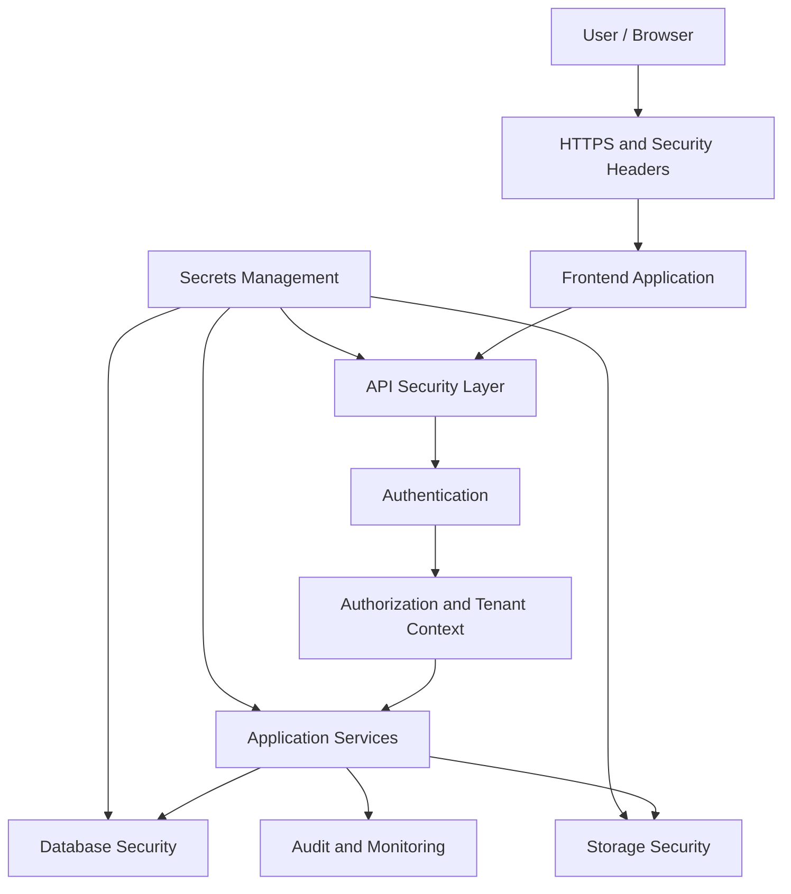

# Security Architecture

**Project:** CaterFlow  
**Document:** Security Architecture  
**Version:** 0.1  
**Status:** Initial specification  
**Last updated:** November 2026

---

## 1. Purpose

This document defines the security principles, requirements, and technical controls for the CaterFlow platform.

CaterFlow is a multi-tenant SaaS application that stores business, customer, employee, financial, and operational information.

Security must be considered throughout the application architecture rather than implemented as an isolated feature.

The main objectives are:

- Protect customer and business information.
- Prevent unauthorized access to tenant data.
- Protect user accounts and authentication sessions.
- Preserve the confidentiality and integrity of financial records.
- Reduce the risk of common web application and API vulnerabilities.
- Support secure file uploads and downloads.
- Provide traceability for critical operations.
- Establish a foundation for GDPR-related privacy requirements.

This document complements:

- `AUTHENTICATION.md`
- `MULTI_TENANCY.md`
- `DATABASE.md`
- `STORAGE.md`
- `ARCHITECTURE.md`

## 2. Security Principles

CaterFlow must follow these principles:

### 2.1 Defense in Depth

Multiple independent security controls must protect sensitive resources.

A failure in one security layer must not automatically expose the entire application.

### 2.2 Least Privilege

Users, application components, database accounts, and infrastructure services must receive only the permissions required for their responsibilities.

### 2.3 Secure by Default

New features must be inaccessible until their authentication, authorization, and tenant-isolation requirements are explicitly implemented.

### 2.4 Zero Trust for Client Input

Frontend validation improves usability but is never considered a security boundary.

All data received from the frontend, external integrations, files, and background processes must be validated by the backend.

### 2.5 Tenant Isolation

A user must never access information belonging to another tenant unless an explicitly authorized platform-level operation permits it.

### 2.6 Fail Securely

When authorization, tenant resolution, or security validation fails, access must be denied.

### 2.7 Auditability

Critical operations must produce audit records that allow administrators to investigate relevant activities.

### 2.8 Data Minimization

The application must collect, process, and retain only information necessary for its business purposes.

## 3. Threat Model

The initial threat model considers the following risks:

| Threat | Potential impact |
|---|---|
| Cross-tenant data exposure | One company accesses another company's information |
| Account compromise | Unauthorized access to business operations |
| Broken access control | Users perform actions outside their permissions |
| SQL injection | Unauthorized database access or modification |
| Cross-Site Scripting (XSS) | Malicious scripts execute in a user's browser |
| Cross-Site Request Forgery (CSRF) | Unauthorized actions using an authenticated session |
| Insecure file uploads | Malicious files affect the application or its users |
| Credential leakage | Unauthorized access to accounts and infrastructure |
| Denial of Service | Application becomes unavailable |
| Sensitive information in logs | Private information becomes accessible through monitoring systems |
| Dependency vulnerabilities | Third-party packages introduce exploitable weaknesses |

Security controls must be reviewed as the product evolves and new integrations are introduced.

## 4. Security Architecture

Security is distributed across several architectural layers.

Each layer must enforce its own responsibilities.

The frontend must not be trusted to enforce permissions or tenant isolation. The backend remains responsible for all security-sensitive decisions.

## 5. Authentication and Session Security

Authentication requirements are defined in `AUTHENTICATION.md`.

The following security principles apply:

- Passwords must never be stored in plaintext.
- Password hashing must use Argon2id or another explicitly approved secure password-hashing algorithm.
- Access tokens must have a limited lifetime.
- Refresh tokens must be securely stored, rotated, and revocable.
- Refresh token reuse must be detected where supported by the authentication design.
- Password recovery must use secure, time-limited tokens.
- Authentication endpoints must have rate limiting.
- Logout must invalidate the relevant session or refresh token.
- Sensitive authentication events must be audited.

JWT validation must include:

- Signature verification.
- Expiration validation.
- Issuer and audience validation where configured.
- Expected signing algorithm validation.
- Token type validation.

The frontend must not be treated as a trusted environment for authorization decisions.

Token storage, refresh lifecycle, CSRF protection, and session management are further specified in `AUTHENTICATION.md`.

## 6. Authorization and Access Control

CaterFlow will use Role-Based Access Control (RBAC).

Permissions must be checked on the backend for every protected operation.

Security requirements:

- Users must belong to an authorized tenant context.
- Tenant membership must be active.
- The requested operation must be allowed by the user's permissions.
- Resource ownership must be verified before returning or modifying data.
- Administrative operations must require explicit permissions.
- Sensitive operations may require additional confirmation or authorization.

The application must prevent:

- Insecure Direct Object References (IDOR).
- Horizontal privilege escalation.
- Vertical privilege escalation.
- Access to resources through predictable identifiers.
- Unauthorized modification of records by changing request payloads.

Knowing a resource UUID must never be sufficient to access it.

## 7. Multi-Tenant Security

Tenant isolation is one of the highest-priority security requirements.

All tenant-owned data must be accessed through a validated tenant context.

The backend must:

1. Authenticate the user.
2. Resolve the requested tenant context.
3. Verify active tenant membership.
4. Verify the required permission.
5. Scope database operations to the authorized tenant.
6. Validate relationships between tenant-owned records.

Additional requirements:

- Tenant identifiers supplied by the frontend must never be trusted without validation.
- Database queries must explicitly enforce tenant scope.
- Foreign-key relationships must not allow cross-tenant references.
- Background jobs must preserve the original tenant context.
- File access must enforce tenant ownership.
- Cache keys must include tenant context whenever cached data is tenant-specific.
- Reports and exports must be tenant-scoped.
- Audit records must preserve tenant identification.

PostgreSQL Row-Level Security (RLS) may be introduced as an additional database protection layer.

Its adoption remains an architectural decision to be documented separately.

See `MULTI_TENANCY.md` and `DATABASE.md`.

## 8. API Security

The REST API must follow secure implementation practices.

### 8.1 HTTPS

All production communication must use HTTPS.

HTTP requests must be redirected to HTTPS or rejected, depending on the deployment configuration.

### 8.2 Request Validation

Every endpoint must validate:

- Request structure.
- Required fields.
- Data types.
- String lengths.
- Numeric ranges.
- Enum values.
- Date and time formats.
- Business constraints.
- Resource relationships.

Pydantic schemas must be used for request validation.

### 8.3 Mass Assignment Protection

The backend must explicitly define which fields users can create or modify.

Sensitive fields must never be accepted blindly from client payloads.

Examples include:

- `tenant_id`
- `user_id`
- `role`
- `permissions`
- `is_active`
- `is_platform_admin`
- Financial approval fields
- Audit metadata

These fields must be controlled by backend logic and authorization rules.

### 8.4 Pagination and Resource Limits

Endpoints returning collections must implement pagination.

The API must enforce:

- Maximum page sizes.
- Maximum request body sizes.
- Query parameter validation.
- Reasonable query complexity.
- Upload size limits.
- Timeouts for expensive operations.

Clients must not be able to request unlimited database results.

### 8.5 Error Handling

API errors must not expose:

- Database connection details.
- SQL statements.
- Internal filesystem paths.
- Stack traces.
- Secrets.
- Internal infrastructure information.

Expected application errors should return consistent responses.

Unexpected exceptions must be logged internally without exposing sensitive implementation details to clients.

### 8.6 API Versioning

The API will use the `/api/v1` prefix.

Breaking changes must be managed through an explicit versioning strategy.

## 9. Common Web and API Vulnerabilities

### 9.1 SQL Injection

SQLAlchemy ORM and parameterized queries must be used.

Raw SQL must only be introduced when necessary and must use parameter binding.

User input must never be concatenated directly into SQL statements.

### 9.2 Cross-Site Scripting (XSS)

The frontend must:

- Avoid rendering untrusted HTML.
- Use React's standard escaping behavior.
- Sanitize content when HTML rendering is explicitly required.
- Avoid unsafe DOM manipulation.
- Implement an appropriate Content Security Policy (CSP).

### 9.3 Cross-Site Request Forgery (CSRF)

If authentication uses cookies, state-changing requests must have appropriate CSRF protection.

Controls may include:

- SameSite cookie attributes.
- CSRF tokens.
- Origin and Referer validation.
- Strict CORS configuration.

The final approach must be consistent with the token storage strategy defined in `AUTHENTICATION.md`.

### 9.4 Cross-Origin Resource Sharing (CORS)

Production CORS configuration must explicitly allow approved frontend origins.

Wildcard origins must not be used with credentialed requests.

Development origins must be separated from production configuration.

### 9.5 Server-Side Request Forgery (SSRF)

If the application later retrieves external URLs, such as remote images or documents, it must validate destinations.

The application must prevent requests to:

- Internal network services.
- Localhost.
- Cloud metadata endpoints.
- Restricted private IP ranges.
- Unexpected protocols.

External URL fetching must be restricted to approved use cases.

### 9.6 Unsafe Deserialization

The application must not deserialize untrusted data using unsafe mechanisms such as unrestricted Python pickle deserialization.

External input must use explicitly defined and validated formats.

### 9.7 Path Traversal

File names and paths supplied by users must never be used directly to construct filesystem paths.

The storage layer must generate safe internal identifiers and enforce tenant ownership.

### 9.8 Denial of Service

The API must implement reasonable protections against excessive requests and resource consumption.

Possible controls include:

- Rate limiting.
- Request size limits.
- Timeouts.
- Pagination.
- Database query optimization.
- Upload restrictions.
- Infrastructure-level traffic protection.

Rate limits should be configurable and may differ between authentication endpoints and normal application operations.

## 10. File and Storage Security

File storage requirements are defined in `STORAGE.md`.

Additional security requirements include:

- Validate file extensions and actual file content.
- Do not trust the client-provided MIME type.
- Enforce maximum file sizes.
- Generate internal file names.
- Prevent path traversal.
- Restrict access to tenant-owned files.
- Avoid executing uploaded files.
- Store sensitive files outside publicly accessible directories.
- Use authorized download mechanisms.
- Apply malware scanning when appropriate and available.

Private documents must never become publicly accessible simply because their URLs are known.

## 11. Secrets Management

Sensitive configuration must never be committed to Git.

Examples include:

- Database credentials.
- JWT signing keys.
- Email provider credentials.
- Object storage credentials.
- External API keys.
- Encryption keys.
- Third-party integration secrets.

Development environments may use local environment files excluded through `.gitignore`.

Production secrets must be provided through a secure deployment secrets mechanism.

Requirements:

- Use separate credentials for development, testing, and production.
- Rotate secrets when exposure is suspected or confirmed.
- Avoid hardcoding secrets in source code.
- Never print secrets in logs.
- Restrict access to production credentials.
- Document secret rotation procedures.
- Use strong cryptographically generated keys.

A `.env.example` file may document variable names and safe example values, but must never contain real credentials.

## 12. Data Protection and Privacy

CaterFlow may process personal information related to:

- Business owners and employees.
- Customers and customer representatives.
- Freelancers.
- Event contacts.
- Users of the platform.

The application must follow data protection principles relevant to GDPR.

### 12.1 Data Minimization

Only information necessary for the platform's operation should be collected.

Optional information must not become mandatory without a business justification.

### 12.2 Encryption in Transit

All production traffic must use HTTPS.

Internal service communication must also be protected according to the deployment architecture and risk level.

### 12.3 Encryption at Rest

Production database storage, backups, and object storage should use encryption at rest.

Where additional application-level encryption is required for particularly sensitive fields, the design must define key management, access control, and recovery procedures.

### 12.4 Data Retention

Retention periods must be defined according to:

- Business requirements.
- Contractual obligations.
- Applicable fiscal and accounting requirements.
- GDPR principles.
- Legal obligations.

The application must support controlled deletion, anonymization, or retention restriction when appropriate.

### 12.5 User Rights

The architecture should support processes for applicable data subject requests, including:

- Access to personal data.
- Correction of inaccurate data.
- Deletion where legally applicable.
- Data export where required.
- Restriction of processing where applicable.

Deletion must not blindly remove financial or audit records that must legally be retained.

### 12.6 Legal Review

This document establishes technical security principles, not a declaration of GDPR compliance.

A qualified legal or privacy professional must review the final data-processing activities, retention periods, privacy notices, contracts, Data Processing Agreements (DPAs), and other applicable obligations.

## 13. Database Security

The database must be protected through multiple controls.

Requirements:

- Use a dedicated application database account.
- Grant only the database permissions required by the application.
- Avoid using superuser credentials in the application.
- Keep database credentials outside source control.
- Enforce tenant-scoped access.
- Use constraints to protect data integrity.
- Restrict database network exposure.
- Encrypt production backups.
- Monitor database access and failures.
- Apply migrations through controlled deployment procedures.

Production database access must be restricted to authorized services and administrators.

Backup and recovery procedures must be documented and tested.

See `DATABASE.md` and `MULTI_TENANCY.md`.

## 14. Logging, Auditing, and Monitoring

Security-relevant events must be recorded.

Examples include:

- Successful and failed authentication attempts.
- Password changes and recovery.
- Session revocation.
- Permission changes.
- User creation and deactivation.
- Tenant membership changes.
- Sensitive financial operations.
- Quotation approval.
- Event cancellation.
- File access and deletion where appropriate.
- Administrative actions.

### 14.1 Sensitive Information in Logs

Logs must never contain:

- Plaintext passwords.
- Access tokens.
- Refresh tokens.
- JWT signing keys.
- Database passwords.
- Payment credentials.
- Unnecessary personal information.

Request bodies must not be logged indiscriminately.

### 14.2 Tenant-Aware Logging

Application logs should include relevant contextual identifiers:

- Request ID.
- Tenant ID.
- User ID.
- Operation or endpoint.
- Timestamp.
- Result or error category.

Tenant identifiers must be treated as contextual metadata, not proof of authorization.

### 14.3 Monitoring

Production monitoring should identify:

- Repeated authentication failures.
- Unusual request volumes.
- Unexpected server errors.
- Database connection failures.
- Storage access failures.
- Suspicious authorization failures.
- Background job failures.

Monitoring systems must follow the same data protection requirements as the application.

## 15. Dependency and Supply Chain Security

CaterFlow will rely on third-party packages and services.

Dependencies must be managed carefully.

Requirements:

- Use dependency lockfiles.
- Avoid unnecessary dependencies.
- Prefer maintained packages with active security support.
- Review package updates before production deployment.
- Monitor known vulnerabilities.
- Apply security patches promptly.
- Avoid installing packages from untrusted sources.
- Keep production dependencies separate from development-only dependencies where possible.

Automated dependency vulnerability scanning should be incorporated into CI/CD.

## 16. Secure Development Practices

Security must be part of the development lifecycle.

Expected practices:

- Review authorization rules during feature development.
- Include tenant-isolation tests for tenant-owned resources.
- Validate all external input.
- Avoid exposing internal implementation details.
- Review dependency changes.
- Use code reviews for sensitive changes.
- Keep secrets out of repositories.
- Run automated tests before merging.
- Review database migrations for security and integrity implications.

Security-sensitive changes should receive additional review.

Examples include authentication, permissions, tenant context, financial operations, storage access, and administrative functionality.

## 17. Security Testing

The test strategy must include security-specific scenarios.

### 17.1 Authentication Tests

- Invalid credentials are rejected.
- Expired tokens are rejected.
- Revoked sessions cannot be reused.
- Refresh token rotation works as expected.
- Authentication rate limits are enforced.

### 17.2 Authorization Tests

- Users cannot execute unauthorized operations.
- Users cannot access resources outside their permissions.
- Changing resource identifiers does not bypass authorization.
- Administrative operations require appropriate permissions.

### 17.3 Tenant Isolation Tests

- Tenant A cannot read Tenant B records.
- Tenant A cannot modify Tenant B records.
- Tenant A cannot delete Tenant B records.
- Cross-tenant relationships are rejected.
- Tenant-specific files cannot be accessed by other tenants.
- Background jobs preserve tenant context.

### 17.4 Input and API Tests

- Invalid payloads are rejected.
- Unexpected fields cannot modify protected attributes.
- Oversized requests are rejected.
- Pagination limits are enforced.
- Error responses do not expose internal details.

### 17.5 Storage Tests

- Unauthorized file access is rejected.
- Invalid file types are rejected.
- Oversized files are rejected.
- File names cannot manipulate storage paths.
- Tenant ownership is validated before download or deletion.

Security testing must be integrated into the normal testing strategy.

See `TESTING.md`.

## 18. Incident Response

A security incident may involve:

- Unauthorized account access.
- Cross-tenant data exposure.
- Credential leakage.
- Database compromise.
- Malicious file uploads.
- Infrastructure compromise.
- Data loss or corruption.

An incident response process must define:

1. Detection and initial assessment.
2. Containment of affected accounts, services, or credentials.
3. Investigation and evidence preservation.
4. Scope and impact assessment.
5. Recovery and restoration.
6. Credential rotation where necessary.
7. Communication with affected stakeholders.
8. Required legal and regulatory notifications.
9. Post-incident review and corrective actions.

Incident handling must be documented in an operational runbook before production launch.

Where personal data breaches occur, notification obligations and applicable deadlines must be assessed with qualified legal or privacy professionals.

## 19. Backup and Recovery Security

Backups must be protected against unauthorized access and accidental exposure.

Requirements:

- Encrypt backups at rest.
- Restrict backup access.
- Store backups separately from the primary database where appropriate.
- Define backup frequency.
- Define retention periods.
- Test restoration procedures.
- Monitor backup execution.
- Protect backup credentials.
- Document recovery objectives.

Recovery Point Objective (RPO) and Recovery Time Objective (RTO) must be defined before production launch.

## 20. Production Security Checklist

The following checklist must be completed before the first production release.

- [ ] HTTPS enabled.
- [ ] Production secrets configured securely.
- [ ] Debug mode disabled.
- [ ] Database access restricted.
- [ ] Tenant isolation tests passing.
- [ ] Authentication and authorization tests passing.
- [ ] CORS configured with approved origins.
- [ ] Security headers configured.
- [ ] Rate limiting enabled.
- [ ] Request and upload size limits configured.
- [ ] Error responses do not expose internal details.
- [ ] File storage access restricted.
- [ ] Production backups configured and encrypted.
- [ ] Backup restoration tested.
- [ ] Logging excludes secrets and sensitive payloads.
- [ ] Dependency vulnerability checks implemented.
- [ ] Monitoring and alerting configured.
- [ ] Incident response procedure documented.
- [ ] Privacy and data retention requirements reviewed.
- [ ] Production access restricted to authorized personnel.

## 21. Future Security Improvements

The following controls may be introduced as the platform grows:

- PostgreSQL Row-Level Security.
- Web Application Firewall (WAF).
- Automated malware scanning.
- Advanced anomaly detection.
- Centralized security monitoring.
- Multi-Factor Authentication (MFA).
- More granular session management.
- Automated security testing in CI/CD.
- External penetration testing.
- Advanced secrets management and key rotation.

These improvements must be prioritized according to risk, cost, and operational complexity.

## 22. Open Decisions

The following decisions remain open:

| Decision | Status |
|---|---|
| PostgreSQL Row-Level Security adoption | To be evaluated |
| Production secrets manager | To be selected |
| Rate limiting implementation | To be selected |
| Security headers and CSP policy | To be defined |
| CSRF protection strategy | Depends on authentication implementation |
| Malware scanning provider | To be evaluated |
| Centralized monitoring provider | To be selected |
| Backup frequency and retention | To be defined |
| RPO and RTO targets | To be defined |
| Security incident notification process | To be documented |
| External penetration testing | To be evaluated |

## 23. Final Principles

Security is a continuous responsibility throughout CaterFlow's lifecycle.

The application must never rely exclusively on frontend validation, UUIDs, JWT authentication, or database constraints to protect sensitive resources.

Authentication, authorization, tenant isolation, database integrity, storage access, infrastructure configuration, and auditability must work together.

Any new feature that introduces access to sensitive information must be reviewed against this security architecture before implementation.

**End of document.**