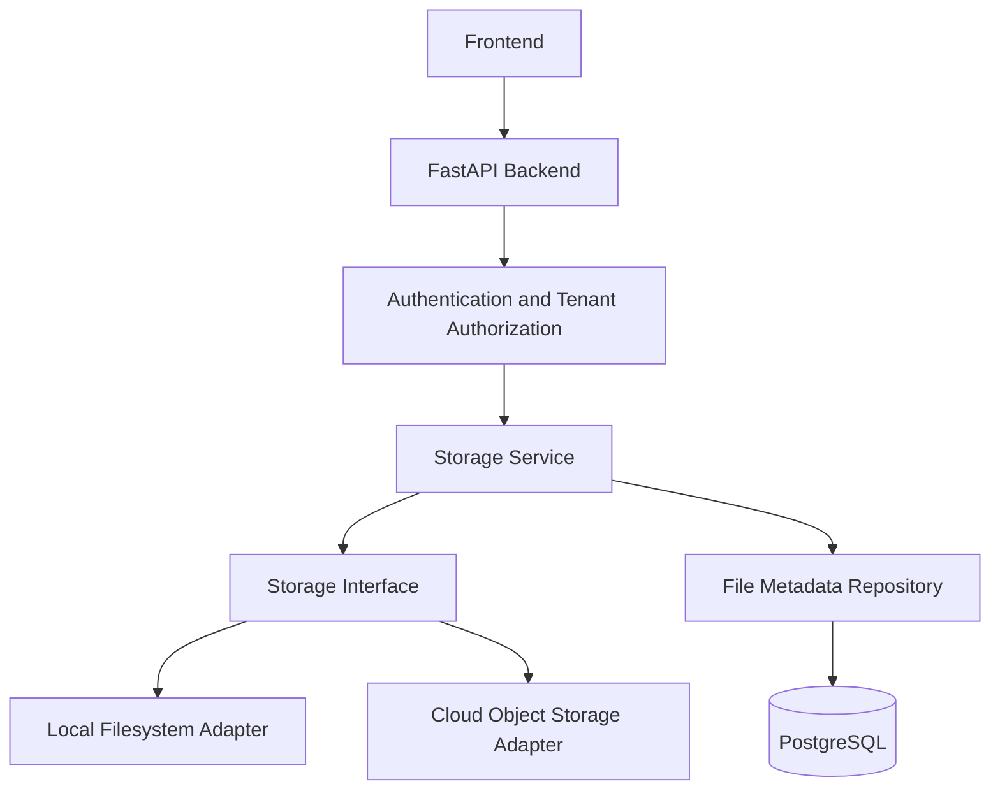
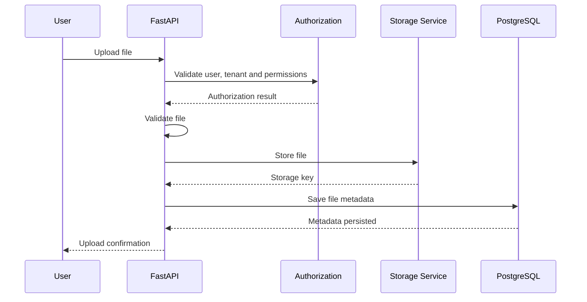

# File Storage Architecture

**Project:** CaterFlow  
**Document version:** 0.1  
**Status:** Initial specification  
**Last updated:** November 2026

---

## 1. Purpose

This document defines the file storage architecture for CaterFlow.

The platform must support file uploads, document generation, file retrieval, and controlled file deletion while preserving tenant isolation and data security.

The storage architecture must support both local development and cloud production environments without coupling business modules to a specific storage provider.

## 2. Storage Requirements

CaterFlow must support the following file categories:

| Category | Examples |
|---|---|
| Tenant branding | Company logos |
| Quotations | Generated quotation PDFs |
| Events | Event documents and attachments |
| Expenses | Receipts and supporting documents |
| Employees | Optional employment-related documents |
| General documents | Other authorized business attachments |

The storage system must provide:

- Tenant-aware file organization.
- Secure upload and retrieval.
- File type validation.
- File size limits.
- Access authorization.
- Metadata persistence.
- Safe file deletion.
- Document generation support.
- Provider-independent application interfaces.

## 3. Storage Strategy

CaterFlow will use an abstraction layer between business modules and the underlying storage provider.

The application must not depend directly on a particular cloud storage SDK.

The initial strategy will support:

### 3.1 Development Environment

Local filesystem storage will be used during development.

Benefits:

- No cloud infrastructure is required.
- Developers can work without external storage accounts.
- File handling can be tested locally.
- Development costs remain minimal.

Local files must be stored outside public frontend directories.

### 3.2 Production Environment

Production will use object storage.

Object storage is appropriate for:

- PDFs.
- Uploaded attachments.
- Logos.
- Receipts.
- Other generated documents.

The specific provider will be selected during deployment planning.

The application must support the provider through a common storage interface.

### 3.3 Storage Architecture Diagram



## 4. Storage Abstraction

All file operations must pass through a centralized storage service.

Business modules must not directly access local directories or cloud provider APIs.

The storage abstraction should expose operations such as:

- Upload a file.
- Retrieve a file.
- Generate a temporary access URL when supported.
- Delete a file.
- Check whether a file exists.
- Retrieve file metadata.

The exact interface will be defined during backend implementation.

### 4.1 Provider Adapters

The architecture should support interchangeable storage adapters.

Initial adapters:

- Local filesystem adapter.
- Cloud object storage adapter.

Both adapters must implement the same application-level contract.

Changing the storage provider must not require changes to quotation, event, expense, or customer business logic.

## 5. File Metadata

PostgreSQL will store file metadata.

The actual file contents will remain in the storage provider.

Initial entity:

`stored_files`

Suggested fields:

| Field | Description |
|---|---|
| id | Unique file identifier |
| tenant_id | Owning tenant |
| storage_key | Internal object identifier |
| original_filename | Original uploaded filename |
| content_type | Validated MIME type |
| file_size | File size in bytes |
| checksum | Optional integrity checksum |
| category | File category |
| status | File processing status |
| uploaded_by | User who uploaded the file |
| created_at | Upload timestamp |
| deleted_at | Optional deletion timestamp |

Additional fields may be introduced when required.

### 5.1 Storage Key

The storage key must be generated by the backend.

The original filename must never be used directly as the storage key.

This prevents:

- Filename collisions.
- Path traversal attacks.
- Accidental overwrites.
- Exposure of internal storage organization.

A UUID-based storage identifier is recommended.

### 5.2 Original Filename

The original filename may be preserved as metadata for display and downloads.

It must be sanitized before being included in response headers or presented in the interface.

It must not determine the physical storage path.

## 6. Tenant Isolation

File storage must follow the same tenant isolation rules established in `MULTI_TENANCY.md`.

Every tenant-owned file must have a valid `tenant_id`.

Conceptual object key structure:

```text
tenants/
    {tenant_id}/
        branding/
        quotations/
        events/
        expenses/
        employees/
        documents/
```

This structure provides organization, but folder naming alone is not a security boundary.

Every file operation must validate:

1. Authenticated user.
2. Active tenant membership.
3. Required permissions.
4. File ownership.
5. Requested operation.

A user must not be able to access another tenant's file by guessing a file identifier or storage key.

## 7. Upload Flow

All file uploads must be validated by the backend.

The initial upload flow should be:

1. User selects a file.
2. Frontend sends the file to the backend.
3. Backend authenticates the user.
4. Backend resolves and validates the active tenant.
5. Backend checks the required permission.
6. Backend validates file size and allowed format.
7. Backend generates a unique storage key.
8. Storage service stores the file.
9. Backend records file metadata in PostgreSQL.
10. Backend returns the file identifier and authorized metadata.

The operation must handle partial failures.

For example, if the file is uploaded successfully but the metadata transaction fails, the system must avoid leaving an unmanaged object indefinitely.

A cleanup or reconciliation process should handle orphaned objects.

### 7.1 Upload Sequence



## 8. File Validation

Uploaded files must be validated before storage.

Validation must include:

- Maximum file size.
- Allowed file extensions.
- Actual file content where practical.
- MIME type consistency.
- Filename sanitization.
- Protection against path traversal.
- Protection against malicious or malformed content.

The system must not trust the MIME type supplied by the browser.

File signatures or content inspection should be used when appropriate.

### 8.1 Initial Allowed Formats

The initial MVP may support:

| File category | Allowed formats |
|---|---|
| Company logos | PNG, JPEG, WebP, SVG subject to sanitization |
| Quotation documents | PDF |
| Expense receipts | PDF, JPEG, PNG, WebP |
| Event attachments | PDF, JPEG, PNG, WebP |
| General documents | PDF, JPEG, PNG, WebP |

SVG uploads require special attention because SVG files can contain active or unsafe content.

If safe sanitization is not implemented, SVG uploads should be rejected.

### 8.2 Initial Size Limits

Recommended initial limits:

| Category | Maximum size |
|---|---:|
| Company logos | 5 MB |
| Receipts | 10 MB |
| Event attachments | 15 MB |
| General documents | 15 MB |

These limits should be configurable and validated by the backend.

The application must also enforce request-level limits to avoid excessive memory or resource consumption.

## 9. File Retrieval

Files must never be publicly accessible by default.

The backend must authorize every retrieval operation.

Supported retrieval approaches:

### 9.1 Backend-Mediated Downloads

The frontend requests a file through the backend.

The backend:

1. Authenticates the user.
2. Validates tenant membership.
3. Checks file ownership.
4. Checks the required permission.
5. Retrieves the file through the storage abstraction.
6. Returns the file with safe response headers.

This approach provides centralized access control.

### 9.2 Temporary Access URLs

Production object storage may support temporary signed URLs.

The backend may generate these URLs after authorization.

Requirements:

- URLs must have short expiration periods.
- URLs must refer only to the requested object.
- The backend must validate tenant ownership before generating them.
- URLs must not be stored as permanent business references.
- Signed URLs must not be written to application logs.
- The application must never assume that a signed URL remains valid indefinitely.

The expiration period should be configurable according to the file's sensitivity.

## 10. File Deletion

File deletion must follow business and retention rules.

The system must distinguish between:

- Removing a file from active application use.
- Deleting the underlying object from storage.
- Retaining metadata for audit or historical purposes.

Financial documents and receipts may be subject to retention requirements.

They must not be permanently deleted through ordinary application operations when retention is required.

A deletion workflow should:

1. Validate authorization.
2. Check retention restrictions.
3. Mark the file as pending deletion or deleted.
4. Perform physical deletion when permitted.
5. Record the result.
6. Preserve required audit information.

Storage deletion should be idempotent.

The system must handle temporary failures and retry safely.

## 11. Document Generation

CaterFlow must generate PDF documents for business operations.

Initial document types:

- Quotation PDFs.
- Event summaries, if required.
- Expense reports, if required.
- Other operational documents introduced later.

### 11.1 PDF Requirements

Generated PDFs must support:

- Tenant branding.
- Company logo.
- Company contact information.
- Tax identification information where applicable.
- Customer details.
- Event information.
- Menu and service descriptions.
- Financial totals.
- Payment conditions.
- Selected document language.

The initial supported languages are:

- Portuguese.
- Spanish.
- English.

PDF generation must use the language selected for the document, not necessarily the user's interface language.

### 11.2 Historical Accuracy

Quotation PDFs must represent the exact quotation version from which they were generated.

Generating a new PDF from an old quotation version must not silently use current catalog prices or current company pricing rules.

The PDF must use the corresponding historical snapshot.

### 11.3 PDF Storage

Generated PDFs should be stored through the storage abstraction.

The database should retain their metadata and relationship to the relevant business entity.

The system may generate new PDF files when a new quotation version is created, while preserving previously issued documents according to the document retention policy.

## 12. File Security

The storage system must protect files against unauthorized access and malicious uploads.

Security requirements:

- Files are private by default.
- All retrievals require authorization.
- Storage keys are generated by the backend.
- Original filenames are not used as physical paths.
- File contents are validated.
- Temporary URLs expire.
- Sensitive file URLs are not logged.
- Production storage must use encryption in transit.
- Provider-side encryption at rest should be enabled where supported.
- Storage credentials must remain server-side.
- Public bucket access must be disabled unless a specific public resource is explicitly approved.

Malware scanning may be introduced as an additional security control, especially for documents uploaded by external users.

It is not a requirement for the initial MVP unless the selected deployment or risk assessment requires it.

## 13. Storage Configuration

Storage configuration must be externalized.

The application must not contain provider credentials or environment-specific storage paths in source code.

Configuration should be supplied through environment variables or a secure configuration mechanism.

Conceptual configuration:

```text
STORAGE_BACKEND=local
STORAGE_LOCAL_PATH=./storage

STORAGE_BUCKET=
STORAGE_REGION=
STORAGE_ENDPOINT=
STORAGE_ACCESS_KEY=
STORAGE_SECRET_KEY=
```

The actual configuration names and provider-specific options will be defined during implementation.

Secrets must never be committed to Git.

Production storage configuration must be managed through secure deployment settings.

## 14. Storage Lifecycle and Cleanup

The system must account for files that become orphaned or are no longer required.

Examples:

- Upload succeeded but metadata persistence failed.
- Metadata exists but the object is missing.
- A temporary document was generated but never associated with a business record.
- A deletion operation failed.

A reconciliation process should periodically identify inconsistencies.

The cleanup process must never delete files solely because they appear old or are temporarily unreferenced without checking ownership and retention rules.

## 15. Backup and Recovery

File storage must have a backup and recovery strategy independent of the database backup strategy.

The production solution must define:

- Object versioning, where supported.
- Backup or replication requirements.
- Retention policies.
- Encryption.
- Access restrictions.
- Recovery procedures.
- Integrity verification.

Database backups and file storage backups must be considered together.

A restored database must not reference files that are permanently unavailable unless the recovery plan explicitly handles this condition.

Restoration procedures must be tested.

## 16. Performance and Scalability

The storage architecture should support increasing file volume without significantly increasing backend complexity.

Recommended practices:

- Stream large files instead of loading them entirely into memory.
- Avoid unnecessary file copies.
- Use temporary signed URLs when appropriate.
- Apply file size limits.
- Use background processing for expensive document generation.
- Keep file metadata queries tenant-scoped and indexed.
- Avoid storing binary file contents directly in PostgreSQL.
- Monitor storage usage and failed operations.

Direct browser-to-object-storage uploads may be considered later if upload volume justifies the additional complexity.

## 17. Testing Requirements

Storage functionality must have dedicated automated tests.

### 17.1 Upload Tests

- Valid files can be uploaded.
- Unsupported formats are rejected.
- Oversized files are rejected.
- Invalid MIME types are rejected.
- Filenames are sanitized.
- Storage keys are generated by the backend.

### 17.2 Isolation Tests

- Tenant A cannot retrieve Tenant B's files.
- Tenant A cannot delete Tenant B's files.
- Guessing a storage key does not bypass authorization.
- Temporary URLs cannot be generated without authorization.

### 17.3 Consistency Tests

- Metadata is persisted after successful uploads.
- Failed metadata transactions do not leave unmanaged files indefinitely.
- Missing objects are detected.
- Deletion operations can be retried safely.
- Historical quotation documents remain associated with the correct quotation version.

### 17.4 Provider Tests

The storage abstraction must be tested independently of any specific provider.

The local adapter must be suitable for automated development and integration tests.

The production adapter must have integration tests using an appropriate isolated environment or provider test setup.

## 18. Initial Backend Organization

Recommended conceptual structure:

```text
backend/app/
    modules/
        storage/
            domain/
            application/
            infrastructure/
                local_storage.py
                object_storage.py
            api/
            schemas/
            models.py
            service.py
```

The storage module should expose application-level operations rather than provider-specific implementation details.

Business modules should depend on the storage interface, not on the underlying adapter.

## 19. Open Decisions

| Decision | Status |
|---|---|
| Production object storage provider | Open |
| Temporary URL expiration | Open |
| Final upload size limits | Proposed |
| Malware scanning | Future consideration |
| Direct browser-to-object-storage uploads | Future consideration |
| File versioning policy | Open |
| Permanent deletion and retention rules | Open |
| PDF rendering library | Open |
| Background document generation | Future implementation decision |
| Storage backup provider and strategy | Open |

These decisions should be finalized before production deployment.

## 20. Architectural Principles

The following principles are mandatory:

1. Business modules must not depend directly on storage providers.
2. File metadata must be stored separately from file contents.
3. Tenant ownership must be validated for every file operation.
4. Files must be private by default.
5. Storage keys must be generated by the backend.
6. Uploaded content must be validated.
7. Historical business documents must preserve their original meaning.
8. Production storage must use secure access controls.
9. Storage failures must be handled without leaving unmanaged data indefinitely.
10. File backup and recovery must be tested.
11. The storage provider must be replaceable without rewriting business modules.

---

**End of document.**