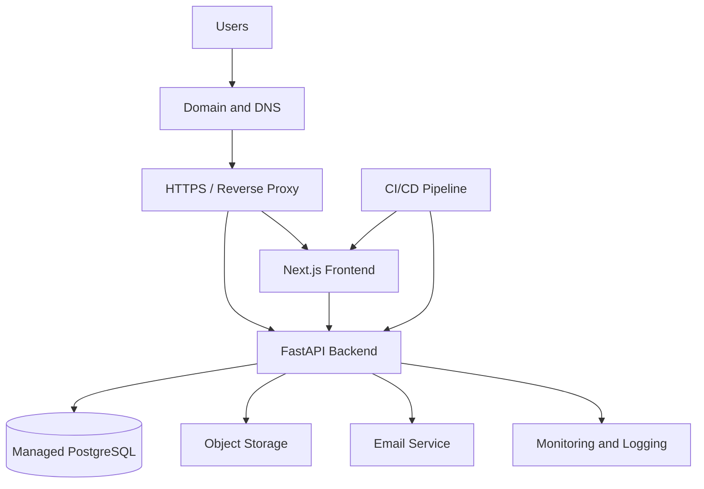
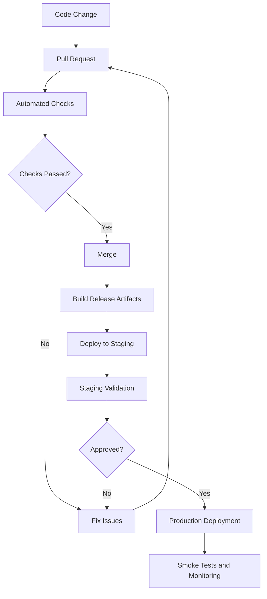

# Deployment Strategy

**Project:** CaterFlow  
**Document:** Deployment Strategy  
**Version:** 0.1  
**Status:** Initial specification

---

## 1. Purpose

This document defines the deployment strategy and operational infrastructure for CaterFlow.

Its objectives are to:

- Establish consistent environments for development, testing, staging, and production.
- Define the expected production deployment architecture.
- Standardize application configuration and secret management.
- Define database migration, backup, and recovery procedures.
- Establish CI/CD expectations.
- Define security and operational requirements.
- Support future growth without introducing unnecessary infrastructure complexity.

This document describes the deployment strategy, not a provider-specific implementation.

The cloud provider and individual infrastructure services will be selected before production deployment.

---

## 2. Deployment Principles

CaterFlow deployment must follow these principles:

1. **Cloud-first:** The production application must be accessible through the internet.
2. **Environment isolation:** Development, testing, staging, and production must remain separated.
3. **Configuration-driven:** Environment-specific settings must not be hardcoded.
4. **Security by default:** Production services must use HTTPS, restricted access, and managed secrets.
5. **Reproducibility:** Deployments must produce predictable and repeatable results.
6. **Database safety:** Database migrations must be controlled and reversible where possible.
7. **Observability:** Application health, errors, and operational metrics must be monitored.
8. **Recoverability:** Production data must be backed up and restoration procedures must be tested.
9. **Scalability:** Infrastructure must support horizontal application scaling when required.
10. **Cost awareness:** Infrastructure must remain appropriate for an early-stage SaaS product.

---

## 3. Deployment Environments

CaterFlow will use four logical environments.

| Environment | Purpose | Data |
|---|---|---|
| Local Development | Developer workstation | Synthetic or anonymized data |
| Test / CI | Automated testing | Disposable test data |
| Staging | Pre-production validation | Synthetic or anonymized data |
| Production | Real customer operations | Actual business data |

### 3.1 Local Development

The local environment must allow developers to run the complete application without depending on production infrastructure.

Expected services:

- Next.js frontend.
- FastAPI backend.
- PostgreSQL database.
- Local file storage.
- Mock or local email service when needed.

Docker Compose will be used to simplify local service orchestration.

Local development must not require access to production credentials or production data.

### 3.2 Test / CI

The test environment must support automated execution of:

- Backend unit tests.
- Backend integration tests.
- API tests.
- Database tests.
- Frontend tests.
- End-to-end tests.

The environment must use isolated databases and disposable test data.

Tests must never modify production data.

### 3.3 Staging

Staging must reproduce the production architecture as closely as reasonably possible.

It will be used for:

- Deployment validation.
- Database migration validation.
- Integration testing.
- Manual acceptance testing.
- PDF generation validation.
- Security and configuration checks.
- Release candidate verification.

Staging must not contain real customer information unless an explicitly approved and legally appropriate anonymization process is implemented.

### 3.4 Production

Production is the environment used by actual catering companies.

It must provide:

- Secure internet access.
- HTTPS.
- Managed or securely operated PostgreSQL.
- Persistent object storage.
- Application monitoring.
- Centralized logs.
- Automated backups.
- Controlled deployment procedures.
- Restricted administrative access.

Production configuration must never be reused in development or staging.

---

## 4. Deployment Architecture

### 4.1 Logical Production Architecture

The initial production architecture will follow this structure:

### 4.2 Frontend Hosting

The Next.js application must be deployed to a hosting environment capable of supporting the selected Next.js deployment mode.

Requirements:

- Production builds must be generated through CI/CD.
- Environment-specific public configuration must be supplied during deployment.
- Server-side secrets must never be exposed to browser code.
- HTTPS must be enforced.
- Static assets should be served efficiently.
- The frontend must communicate with the backend through the configured API URL.

The final hosting platform remains an open decision.

### 4.3 Backend Hosting

The FastAPI application must run in a production-capable Python environment.

Requirements:

- Use a production ASGI server configuration.
- Disable development reload functionality.
- Disable debug mode.
- Configure resource limits.
- Expose health and readiness endpoints.
- Support graceful shutdown.
- Use secure database connections.
- Keep application instances stateless whenever possible.

The backend must not depend on local container storage for persistent business data.

### 4.4 Database Hosting

PostgreSQL will be the primary production database.

Preferred initial approach:

- Managed PostgreSQL service.
- Private network access whenever supported.
- TLS connections.
- Automated backups.
- Restricted database credentials.
- Monitoring of database resource usage.
- Separate databases or isolated instances for staging and production.

The database must not be publicly accessible without a strong operational justification and additional security controls.

### 4.5 Object Storage

Production files must use an object storage service through the storage abstraction defined in `STORAGE.md`.

Expected content includes:

- Tenant logos.
- Generated quotations.
- Event documents.
- Receipts and expense attachments.
- Other supported business documents.

Requirements:

- Private storage by default.
- Tenant-aware access validation.
- Restricted service credentials.
- Encryption in transit and at rest where supported.
- Configurable retention and deletion policies.
- Backup or recovery strategy appropriate to the selected provider.

Temporary signed URLs may be used for controlled file downloads when appropriate.

---

## 5. Local Development Deployment

### 5.1 Docker Compose

Docker Compose will orchestrate local services.

Expected services:

| Service | Responsibility |
|---|---|
| frontend | Next.js application |
| backend | FastAPI application |
| db | PostgreSQL |
| storage | Local persistent file storage |
| mail | Optional local email testing service |

The exact service configuration will be defined during implementation.

### 5.2 Local Persistence

Persistent Docker volumes should be used for:

- PostgreSQL data.
- Local uploaded files.

Developers must be able to reset the local environment without affecting other environments.

### 5.3 Local Configuration

Local configuration must be stored in environment-specific files excluded from Git.

A `.env.example` file must document the required variables without containing real secrets.

---

## 6. Configuration and Environment Variables

Application configuration must be provided through environment variables or an equivalent secure configuration mechanism.

Examples of configuration categories:

| Category | Examples |
|---|---|
| Application | APP_ENV, DEBUG, APP_URL |
| API | API_HOST, API_PORT, API_BASE_URL |
| Database | DATABASE_URL |
| Authentication | JWT_SECRET_KEY, JWT_ACCESS_TOKEN_EXPIRE_MINUTES |
| Storage | STORAGE_BACKEND, STORAGE_BUCKET |
| Email | SMTP_HOST, SMTP_PORT, EMAIL_FROM |
| CORS | CORS_ALLOWED_ORIGINS |
| Monitoring | LOG_LEVEL, ERROR_TRACKING_DSN |

These names are illustrative and may be refined during implementation.

### 6.1 Secret Management

The following values must be treated as secrets:

- Database credentials.
- JWT signing keys.
- Email provider credentials.
- Object storage credentials.
- Third-party API keys.
- Other private integration credentials.

Rules:

1. Never commit secrets to Git.
2. Never include secrets in application logs.
3. Never expose server-side secrets through frontend public variables.
4. Use the hosting provider's secret management mechanism in production.
5. Rotate credentials when compromise is suspected or when operational policy requires it.
6. Maintain different secrets for each environment.

### 6.2 Environment Configuration Files

The repository should include:

- `.env.example` for documented configuration.
- Local environment files excluded through `.gitignore`.
- Environment-specific production and staging configuration managed outside the repository.

---

## 7. Database Deployment and Migrations

Database schema changes must be managed through Alembic migrations.

### 7.1 Migration Rules

- Every database schema change must have a migration.
- Migrations must be committed to Git.
- Migrations must be tested before production deployment.
- Production migrations must be executed through a controlled deployment process.
- Manual production schema changes must be avoided.
- Destructive migrations require additional review and a recovery plan.

### 7.2 Deployment Order

The expected deployment sequence is:

1. Validate the release candidate.
2. Verify database backup availability.
3. Apply compatible database migrations.
4. Deploy the backend.
5. Verify backend health and readiness.
6. Deploy the frontend.
7. Run critical smoke tests.
8. Monitor the application after release.

The exact order may change when a release requires backward-compatible frontend and backend coordination.

### 7.3 Backward Compatibility

Database migrations should follow an expand-and-contract strategy when breaking changes are involved.

Typical sequence:

1. Add new schema elements without removing existing ones.
2. Deploy application code compatible with both schemas.
3. Migrate or backfill existing data.
4. Verify application behavior.
5. Remove obsolete schema elements in a later deployment.

This reduces the risk of downtime during deployments and rollbacks.

### 7.4 Health Endpoints

The backend should expose:

- A liveness endpoint to indicate that the application process is running.
- A readiness endpoint to indicate that the application can accept requests.

The readiness check should verify critical dependencies, including database connectivity.

Health endpoints must not expose credentials, internal configuration, or sensitive infrastructure details.

---

## 8. Frontend Deployment

The frontend deployment process must include:

1. Dependency installation.
2. Static analysis and linting.
3. Type checking.
4. Automated tests.
5. Production build.
6. Deployment to the target hosting environment.
7. Post-deployment smoke tests.

The frontend must use the correct API URL for each environment.

Public frontend variables must contain only information safe to expose to users.

Private credentials and server-side configuration must remain on the backend or in secure hosting configuration.

---

## 9. CI/CD Pipeline

CaterFlow should use an automated CI/CD pipeline.

The specific provider remains an open decision.

### 9.1 Continuous Integration

Every relevant pull request or branch update should trigger:

- Dependency validation.
- Backend linting.
- Backend type checking where configured.
- Backend automated tests.
- Frontend linting.
- Frontend type checking.
- Frontend automated tests.
- Production build validation.
- Migration validation.

A change must not be considered ready for deployment if required checks fail.

### 9.2 Continuous Deployment

The recommended release workflow is:

### 9.3 Release Requirements

- Production deployments must use validated release artifacts.
- The deployed version must be identifiable.
- Deployment logs must not expose secrets.
- Production deployment should require an explicit approval step.
- Failed deployments must trigger an investigation and recovery procedure.
- Staging and production must use separate credentials.

---

## 10. Domain, HTTPS, and Network Configuration

Production must use a registered domain.

Requirements:

- DNS records must point to the appropriate hosting infrastructure.
- HTTPS must be enabled.
- TLS certificates must be renewed automatically whenever supported.
- HTTP requests should redirect to HTTPS.
- CORS must allow only the required frontend origins.
- Security headers must be configured.
- Administrative and database interfaces must not be unnecessarily exposed to the public internet.

The final domain structure is still to be defined.

A possible future structure is:

- `app.example.com` for the application.
- `api.example.com` for the backend API.

These are illustrative placeholders, not selected domains.

---

## 11. Monitoring and Logging

Production must provide enough observability to detect failures and investigate incidents.

### 11.1 Application Logging

Logs should include:

- Timestamp.
- Log level.
- Service name.
- Application version.
- Request or correlation ID.
- Relevant operation context.
- Error details when applicable.

Logs must not include:

- Passwords.
- Authentication tokens.
- Secret keys.
- Full payment credentials.
- Unnecessary personal information.
- Sensitive customer or employee data.

Tenant identifiers may be included when necessary for operational investigation, provided access to logs is appropriately restricted.

### 11.2 Monitoring

The initial monitoring strategy should cover:

- Application availability.
- API response times.
- HTTP error rates.
- Backend exceptions.
- Database connectivity.
- Database resource consumption.
- Storage failures.
- Deployment failures.

### 11.3 Alerts

Alerts should be configured for critical operational conditions, such as:

- Application downtime.
- Repeated API failures.
- Database connection failures.
- Unusual resource consumption.
- Backup failures.
- Unexpected storage errors.

Monitoring thresholds must be defined based on actual production behavior rather than arbitrary assumptions.

---

## 12. Backup and Disaster Recovery

Production business data must be protected against accidental loss, infrastructure failure, and operational mistakes.

### 12.1 Database Backups

The production database must have automated backups.

The selected backup strategy should evaluate:

- Backup frequency.
- Backup retention.
- Point-in-time recovery availability.
- Backup encryption.
- Backup access permissions.
- Recovery procedures.

### 12.2 Object Storage Recovery

The object storage strategy must address:

- Accidental deletion.
- File corruption.
- Unauthorized modification.
- Retention requirements.
- Recovery of business documents.

Versioning or other recovery mechanisms should be evaluated according to provider capabilities and cost.

### 12.3 Restore Testing

Backups must not be considered reliable until restoration has been tested.

Recovery tests should verify:

- Database restoration.
- Application compatibility with restored data.
- File availability.
- Tenant data integrity.
- Critical business workflows.

### 12.4 Recovery Objectives

The following values must be defined before production launch:

- **RPO (Recovery Point Objective):** Maximum acceptable amount of data loss measured in time.
- **RTO (Recovery Time Objective):** Maximum acceptable time to restore service.

These objectives depend on business requirements, infrastructure costs, and operational capacity.

---

## 13. Background Jobs

The initial architecture does not require a separate worker service unless asynchronous operations become necessary.

Potential future background jobs include:

- Email delivery.
- PDF generation.
- Scheduled reminders.
- Data exports.
- Periodic cleanup.
- Report generation.

When introduced, background workers must:

- Preserve tenant context.
- Use controlled retries.
- Avoid duplicate processing.
- Record relevant failures.
- Respect transaction and idempotency rules.
- Use appropriate queue and job monitoring.

Background processing must not bypass authorization or tenant isolation rules.

---

## 14. Scaling Strategy

The initial infrastructure should prioritize simplicity and reliability.

The architecture must nevertheless allow future scaling.

### 14.1 Application Scaling

The frontend and backend should remain independently deployable.

Backend instances should be stateless whenever possible, allowing horizontal scaling.

### 14.2 Database Scaling

Initial database optimization should focus on:

- Appropriate indexes.
- Query optimization.
- Connection pooling.
- Efficient pagination.
- Monitoring slow queries.
- Correct tenant-scoped query patterns.

Read replicas, database sharding, or more complex database architectures should only be considered when justified by measured requirements.

### 14.3 Storage Scaling

Business files must remain outside the application container.

Object storage should handle persistent files independently of backend instance lifecycle.

---

## 15. Security Hardening

Before production launch, the deployment must satisfy the following requirements:

- Debug mode disabled.
- HTTPS enforced.
- Secure secrets management configured.
- Database access restricted.
- Object storage private by default.
- Production credentials separated from staging.
- CORS restricted to approved origins.
- Rate limiting configured for sensitive endpoints.
- Dependencies checked for known vulnerabilities.
- Administrative access protected.
- Backups enabled.
- Logs reviewed for sensitive information.
- Application and infrastructure access permissions restricted according to least privilege.

Security requirements defined in `SECURITY.md` remain mandatory.

---

## 16. Deployment and Rollback Procedure

Every production release must have a documented deployment and recovery procedure.

### 16.1 Before Deployment

- Confirm that automated checks passed.
- Confirm that staging validation succeeded.
- Review migration changes.
- Confirm backup availability.
- Identify the release version.
- Verify required environment variables.
- Prepare a rollback or recovery plan.

### 16.2 During Deployment

- Apply compatible migrations.
- Deploy the backend.
- Verify readiness.
- Deploy the frontend.
- Execute smoke tests.
- Monitor errors and response times.

### 16.3 Rollback

When a release introduces a critical problem:

1. Stop further deployment activity.
2. Identify whether the issue is application code, infrastructure, or database related.
3. Roll back the application to a known working release when safe.
4. Preserve database integrity.
5. Do not automatically reverse migrations that may have destroyed or transformed data.
6. Restore from backup only when necessary and following an approved recovery procedure.
7. Verify critical business workflows.
8. Document the incident and corrective actions.

Database migrations must be designed with rollback implications in mind.

---

## 17. Operational Runbook

A production runbook must be maintained with procedures for:

- Application deployment.
- Application rollback.
- Database migration.
- Database backup verification.
- Database restoration.
- Object storage recovery.
- Secret rotation.
- Service restart.
- Incident investigation.
- Access revocation.
- Production environment configuration.

Operational documentation must be updated whenever deployment architecture or critical procedures change.

---

## 18. Production Readiness Checklist

Before the first production release, verify:

- [ ] Production frontend deployed.
- [ ] Production backend deployed.
- [ ] PostgreSQL configured securely.
- [ ] Database migrations applied successfully.
- [ ] Object storage configured.
- [ ] HTTPS enabled.
- [ ] Domain and DNS configured.
- [ ] Environment variables validated.
- [ ] Secrets stored securely.
- [ ] CORS configured.
- [ ] Authentication and authorization validated.
- [ ] Tenant isolation tests passing.
- [ ] Monitoring configured.
- [ ] Error logging configured.
- [ ] Database backups enabled.
- [ ] Backup restoration tested.
- [ ] Critical workflows validated.
- [ ] Production deployment and rollback procedures documented.
- [ ] GDPR and applicable legal obligations reviewed with qualified professionals.

---

## 19. Cost Management

Infrastructure costs must be monitored from the beginning.

The initial deployment should avoid unnecessary services and infrastructure complexity.

Cost monitoring should include:

- Frontend hosting.
- Backend compute.
- PostgreSQL hosting.
- Object storage.
- Network transfer.
- Email delivery.
- Monitoring and logging.
- Backup storage.

Infrastructure upgrades should be based on actual usage, reliability requirements, and business growth.

The project must avoid introducing expensive infrastructure before it is justified.

---

## 20. Open Technical Decisions

The following decisions remain open:

| ID | Decision | Status |
|---|---|---|
| DEP-001 | Cloud provider | Open |
| DEP-002 | Frontend hosting platform | Open |
| DEP-003 | Backend hosting platform | Open |
| DEP-004 | Managed PostgreSQL provider | Open |
| DEP-005 | Object storage provider | Open |
| DEP-006 | Email delivery provider | Open |
| DEP-007 | CI/CD provider | Open |
| DEP-008 | Monitoring and error tracking provider | Open |
| DEP-009 | Production domain structure | Open |
| DEP-010 | Backup frequency and retention | Open |
| DEP-011 | RPO and RTO targets | Open |
| DEP-012 | Background worker strategy | Deferred |
| DEP-013 | Production resource sizing | Open |

These decisions must be evaluated before the production deployment milestone.

---

## 21. Final Principles

The CaterFlow deployment strategy must ensure that:

1. Local development remains simple and reproducible.
2. Staging provides meaningful production validation.
3. Production infrastructure is secure and reliable.
4. Application instances do not own persistent business data.
5. Database changes are controlled and tested.
6. Customer data and files can be recovered.
7. Deployments are traceable and repeatable.
8. Infrastructure can scale without requiring architectural redesign.
9. Operational complexity remains proportional to the product's maturity.

This document establishes the deployment baseline for CaterFlow. Provider-specific implementation details will be defined when the infrastructure decisions are finalized.