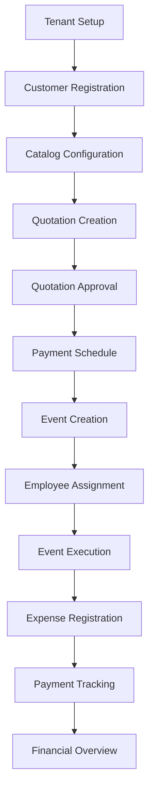

# Development Roadmap

**Project:** CaterFlow  
**Document:** Development Roadmap  
**Version:** 0.1  
**Status:** Initial specification  
**Last updated:** November 2026

---

## 1. Purpose

This document defines the implementation roadmap for CaterFlow.

It organizes development into milestones with clear objectives, deliverables, dependencies, and completion criteria.

The roadmap aims to:

- Establish a predictable development sequence.
- Prioritize foundational architecture before business features.
- Reduce implementation risks.
- Deliver working functionality incrementally.
- Validate critical business workflows early.
- Prepare the platform for production deployment.

The roadmap represents the planned implementation sequence. Milestones must only be marked as completed after their acceptance criteria have been verified.

## 2. Development Strategy

CaterFlow will be developed incrementally using a modular monolith architecture.

The implementation strategy follows these principles:

1. Establish the development environment and project foundation.
2. Implement authentication and tenant isolation.
3. Build shared business foundations.
4. Implement core business workflows.
5. Add financial management and reporting.
6. Complete the user experience and localization.
7. Validate security and production readiness.
8. Deploy and validate the MVP with an initial catering company.

The application must remain usable and testable throughout development.

## 3. Milestone Overview

| Milestone | Name | Priority |
|---|---|---|
| M0 | Project Foundation | Critical |
| M1 | Authentication and Multi-Tenancy | Critical |
| M2 | Tenant Configuration and Business Foundations | High |
| M3 | Customers and Catalog | High |
| M4 | Pricing and Quotations | Critical |
| M5 | Events and Workforce | Critical |
| M6 | Payments and Expenses | Critical |
| M7 | Dashboard and Financial Reporting | High |
| M8 | Localization and Document Generation | High |
| M9 | Security, Quality, and Production Readiness | Critical |
| M10 | Cloud Deployment and Initial Validation | Critical |

The sequence may be adjusted when implementation reveals dependencies or risks that require a different order.

---

## 4. M0 — Project Foundation

**Objective:** Establish the technical foundation and development environment.

### Scope

Backend:

- Initialize Python project.
- Configure FastAPI.
- Configure SQLAlchemy 2.x.
- Configure Alembic.
- Configure Pydantic.
- Configure Pytest.
- Establish application configuration.
- Establish database connection management.
- Configure centralized error handling.
- Establish API versioning.

Frontend:

- Initialize Next.js.
- Configure TypeScript.
- Configure Tailwind CSS.
- Configure shadcn/ui.
- Establish application layout.
- Configure environment variables.
- Establish frontend API communication structure.

Infrastructure:

- Configure Docker Compose for local development.
- Configure PostgreSQL.
- Establish development environment variables.
- Configure Git ignore rules.
- Establish initial CI pipeline.

Documentation:

- Review setup instructions.
- Document development commands.
- Document environment configuration.

### Deliverables

- Running FastAPI application.
- Running Next.js application.
- PostgreSQL development database.
- Initial Alembic migration setup.
- Basic frontend/backend communication.
- Initial automated tests.
- Reproducible local development environment.

### Acceptance Criteria

- Backend starts successfully.
- Frontend starts successfully.
- Backend connects to PostgreSQL.
- Alembic can apply an initial migration.
- Frontend can communicate with the backend.
- Automated tests execute successfully.
- CI validates the initial project structure.

**Dependencies:** None.

---

## 5. M1 — Authentication and Multi-Tenancy

**Objective:** Establish secure user identity, tenant membership, and data isolation.

### Scope

Identity:

- User registration.
- Login.
- Password hashing.
- Access token generation.
- Refresh token lifecycle.
- Logout.
- Password recovery.
- Email verification where configured.

Tenant management:

- Tenant creation.
- Tenant information.
- Tenant membership.
- Tenant selection.
- Tenant switching.
- Tenant activation and deactivation.

Authorization:

- Initial RBAC implementation.
- Owner role.
- Administrator role.
- Manager role.
- Staff role.
- Finance role.
- Viewer role.
- Permission checks.

Security:

- Authentication middleware/dependencies.
- Tenant context resolution.
- Tenant-scoped database access.
- Session revocation.
- Authentication rate limiting.

### Deliverables

- Identity module.
- Tenants module.
- User and membership persistence.
- Authentication API.
- Tenant context implementation.
- Initial permission system.
- Security and tenant-isolation tests.

### Acceptance Criteria

- Users can register and authenticate.
- Passwords are stored securely.
- Access and refresh tokens follow the authentication specification.
- Users can access only active tenant memberships.
- Users can switch between authorized tenants.
- Permissions are enforced by the backend.
- Cross-tenant access tests pass.
- Revoked sessions cannot be reused.

**Dependencies:** M0.

---

## 6. M2 — Tenant Configuration and Business Foundations

**Objective:** Allow each catering company to configure its business environment.

### Scope

Company configuration:

- Business name.
- Logo.
- Contact information.
- Address.
- Tax identification information.
- Default currency.
- Default language.
- Timezone.
- Business settings.

Operational configuration:

- Payment terms.
- Default payment conditions.
- Quotation validity period.
- Menu change deadlines.
- Basic event settings.

Users and permissions:

- Invite users.
- Manage memberships.
- Assign roles.
- Activate and deactivate users.

Infrastructure:

- Tenant-specific configuration loading.
- Initial audit logging.
- Tenant-specific branding support.

### Deliverables

- Tenant settings module.
- Company profile interface.
- User and membership management interface.
- Initial audit records.
- Tenant configuration API.

### Acceptance Criteria

- Each tenant can configure its company information.
- Configuration is isolated between tenants.
- Tenant settings persist correctly.
- Users can be assigned authorized roles.
- Relevant configuration changes are audited.
- Default currency and timezone are applied consistently.

**Dependencies:** M1.

---

## 7. M3 — Customers and Catalog

**Objective:** Implement the basic commercial data required to prepare catering quotations.

### Scope

Customers:

- Customer creation.
- Customer listing.
- Customer details.
- Customer editing.
- Customer archiving.
- Customer search and filtering.

Catalog:

- Food items.
- Beverages.
- Menus.
- Menu categories.
- Item descriptions.
- Unit types.
- Base prices.
- Active/inactive status.

Data integrity:

- Tenant ownership.
- Validation.
- Historical reference preservation.
- Basic search and pagination.

### Deliverables

- Customers module.
- Catalog module.
- Customer management interface.
- Catalog management interface.
- Database migrations.
- Automated tests.

### Acceptance Criteria

- Tenants can manage their own customers.
- Tenants can manage their own catalog.
- Catalog items can be organized by category.
- Archived records remain available for historical references.
- Cross-tenant access is prevented.
- Search and pagination work correctly.

**Dependencies:** M2.

---

## 8. M4 — Pricing and Quotations

**Objective:** Implement the commercial workflow from pricing configuration to quotation approval.

### Scope

Pricing:

- Base item prices.
- Menu pricing.
- Quantity-based calculations.
- Event-related pricing.
- Optional additional charges.
- Configurable discounts.

Quotations:

- Quotation creation.
- Customer association.
- Event information.
- Guest count.
- Event type.
- Service format.
- Menu selection.
- Employee and service cost estimates.
- Multiple commercial proposals where appropriate.
- Quotation versions.
- Quotation PDF generation.
- Quotation approval.
- Quotation rejection.
- Quotation revision.

Payment conditions:

- Configurable payment terms.
- Percentage-based installments.
- Fixed-amount installments.
- Due date configuration.
- Payment schedule generation upon approval.

Historical integrity:

- Immutable quotation versions.
- Approval snapshot.
- Approved amount preservation.
- Approved payment terms preservation.

### Deliverables

- Pricing module.
- Quotations module.
- Quotation versioning.
- Quotation approval workflow.
- Initial PDF generation.
- Payment schedule generation.
- Financial calculation tests.

### Acceptance Criteria

- Users can create and revise quotations.
- Pricing calculations are performed by the backend.
- Previous quotation versions remain preserved.
- Approval identifies the exact approved version.
- Payment installments reconcile with the approved amount.
- Approved commercial terms cannot be silently modified.
- Generated PDFs reflect the correct quotation version.
- All critical financial calculations pass automated tests.

**Dependencies:** M3.

---

## 9. M5 — Events and Workforce

**Objective:** Convert approved quotations into operational events and manage the employees responsible for delivery.

### Scope

Events:

- Event creation from approved quotations.
- Event details.
- Event scheduling.
- Event status management.
- Event updates.
- Event cancellation.
- Event history.

Initial event statuses:

- Scheduled.
- Confirmed.
- In Preparation.
- In Progress.
- Completed.
- Cancelled.

Workforce:

- Employee registration.
- Permanent employee support.
- Freelancer support.
- Employee roles.
- Event assignments.
- Planned hours.
- Actual hours.
- Hourly compensation.
- Fixed compensation per event.
- Historical compensation snapshots.

Operational management:

- Employee assignment changes.
- Assignment history.
- Event staffing overview.
- Operational notes where appropriate.

### Deliverables

- Events module.
- Workforce module.
- Event management interface.
- Employee management interface.
- Assignment management.
- Compensation calculation services.

### Acceptance Criteria

- Approved quotations can be converted into events.
- Conversion is idempotent.
- Event information preserves the approved commercial snapshot.
- Employees can be assigned to events.
- Planned and actual hours can be recorded.
- Compensation methods work correctly.
- Historical compensation is preserved.
- Event cancellation does not automatically delete financial records.

**Dependencies:** M4.

---

## 10. M6 — Payments and Expenses

**Objective:** Implement financial tracking and event cost management.

### Scope

Payments:

- Payment installment tracking.
- Payment registration.
- Partial payments.
- Full payments.
- Outstanding balances.
- Overdue installments.
- Payment cancellation or reversal.
- Refund records where applicable.

Initial payment statuses:

- Pending.
- Partially Paid.
- Paid.
- Overdue.
- Cancelled.

Expenses:

- Expense registration.
- Event association.
- Expense categories.
- Expense descriptions.
- Expense dates.
- Expense amounts.
- Expense corrections and reversals.

Initial expense categories:

- Food and ingredients.
- Beverages.
- Workforce.
- Transportation.
- Other.

Financial rules:

- Preserve historical payment records.
- Preserve historical expenses.
- Avoid duplicate workforce cost recognition.
- Separate estimated costs from actual expenses.
- Separate event completion from financial settlement.

### Deliverables

- Payments module.
- Expenses module.
- Payment management interface.
- Expense management interface.
- Financial reconciliation services.
- Financial calculation tests.

### Acceptance Criteria

- Payments can be registered against installments.
- Partial payments update outstanding balances correctly.
- Overdue installments are identified.
- Expense records can be associated with events.
- Corrections and reversals preserve history.
- Workforce costs are not double-counted.
- Event status and payment status remain independent.
- Financial summaries reconcile with source records.

**Dependencies:** M5.

---

## 11. M7 — Dashboard and Financial Reporting

**Objective:** Provide an overview of business operations and financial performance.

### Scope

Operational dashboard:

- Upcoming events.
- Events in preparation.
- Events in progress.
- Completed events.
- Cancelled events.
- Employee allocation overview.

Financial dashboard:

- Approved quotation value.
- Payments received.
- Outstanding balances.
- Actual expenses.
- Estimated costs.
- Event financial results.

Filtering:

- Date range.
- Event status.
- Customer.
- Event type.
- Relevant financial categories.

Reporting:

- Event-level financial summaries.
- Period-based summaries.
- Payment summaries.
- Expense summaries.
- Basic operational reports.

### Deliverables

- Reporting module.
- Dashboard API.
- Dashboard interface.
- Financial aggregation services.
- Reporting tests.

### Acceptance Criteria

- Dashboard values match underlying records.
- Financial metrics distinguish received payments from approved revenue.
- Outstanding balances are calculated correctly.
- Event expenses are not duplicated.
- Filters return the correct tenant-scoped results.
- Reporting respects user permissions.

**Dependencies:** M6.

---

## 12. M8 — Localization and Document Generation

**Objective:** Complete the multilingual experience and professional business documents.

### Scope

Localization:

- Portuguese interface.
- Spanish interface.
- English interface.
- Language selection.
- Translation management.
- Locale-aware dates.
- Locale-aware numbers.
- Locale-aware currency formatting.
- Timezone-aware event displays.

Documents:

- Quotation PDFs.
- Company branding.
- Logo support.
- Selected document language.
- Customer information.
- Event information.
- Quotation version information.
- Payment conditions.
- Document layout consistency.

Storage:

- Production object storage integration.
- Secure document retrieval.
- Tenant-specific file access.
- Storage lifecycle handling.

### Deliverables

- Complete initial localization.
- Multilingual quotation documents.
- Tenant branding in PDFs.
- Production storage adapter.
- Localization and document tests.

### Acceptance Criteria

- All supported interface languages work.
- Translation keys are complete for released features.
- Dates and currency values use the selected locale.
- Tenant timezone is respected.
- PDFs use the selected language and correct branding.
- Private documents cannot be accessed by unauthorized tenants.
- Storage works independently of the selected provider.

**Dependencies:** M7, with localization foundations introduced earlier where necessary.

---

## 13. M9 — Security, Quality, and Production Readiness

**Objective:** Validate the complete application before production deployment.

### Scope

Security:

- Authentication review.
- Authorization review.
- Tenant-isolation review.
- API security review.
- Storage security review.
- Secrets management.
- Security headers.
- CORS configuration.
- Rate limiting.
- Dependency vulnerability checks.

Quality:

- Backend regression tests.
- Frontend regression tests.
- End-to-end tests.
- Financial reconciliation tests.
- Performance testing.
- Error handling review.

Operations:

- Structured logging.
- Monitoring.
- Backup configuration.
- Recovery procedures.
- Incident response documentation.
- Production environment configuration.

Privacy:

- Data retention review.
- Privacy-related requirements review.
- Access and deletion workflows where applicable.
- Legal and privacy review.

### Deliverables

- Security validation report.
- Automated test results.
- Production configuration.
- Backup and recovery procedures.
- Monitoring and logging setup.
- Release checklist.

### Acceptance Criteria

- Critical tests pass.
- No known unresolved critical security vulnerabilities remain without an approved mitigation.
- Tenant isolation tests pass.
- Financial calculations are validated.
- Production secrets are configured securely.
- Backups are configured and restoration is tested.
- Monitoring and logging are operational.
- Privacy and legal requirements have received appropriate review.

**Dependencies:** M8.

---

## 14. M10 — Cloud Deployment and Initial Validation

**Objective:** Deploy CaterFlow as a cloud-hosted SaaS and validate the MVP with an initial catering company.

### Scope

Cloud infrastructure:

- Production backend deployment.
- Production frontend deployment.
- Managed PostgreSQL.
- Production object storage.
- HTTPS.
- Domain configuration.
- Environment configuration.
- Database migrations.
- Backup scheduling.

Release:

- Production build.
- Initial tenant setup.
- Owner account creation.
- Company configuration.
- Initial user onboarding.

Validation:

- Realistic business workflow testing.
- Quotation preparation.
- Quotation approval.
- Event scheduling.
- Employee assignments.
- Payment registration.
- Expense registration.
- Dashboard validation.

Feedback:

- Collect initial user feedback.
- Identify usability problems.
- Identify missing workflows.
- Prioritize corrections.
- Document lessons learned.

### Deliverables

- Deployed CaterFlow MVP.
- Production database.
- Production storage.
- Initial tenant configured.
- Initial users onboarded.
- Operational monitoring.
- Initial validation report.

### Acceptance Criteria

- Application is accessible through its production domain.
- HTTPS works.
- Authentication and tenant isolation work in production.
- Database migrations complete successfully.
- Files can be uploaded and retrieved securely.
- Critical business workflows work end to end.
- Backups and monitoring are operational.
- Initial catering company can use the application for controlled validation.

**Dependencies:** M9.

---

## 15. MVP Release Definition

The MVP is considered functionally complete when the following workflow works end to end:

The MVP must allow a catering company to manage its basic commercial, operational, and financial workflows without relying exclusively on external spreadsheets or paper records.

The MVP does not require a public marketplace, customer portal, integrated payment gateway, native mobile application, advanced inventory management, or AI functionality.

## 16. Prioritization Strategy

Features must be prioritized according to:

1. Security and data integrity.
2. Dependencies between modules.
3. Core business value.
4. Operational usability.
5. Implementation complexity.
6. Validation opportunities.

A feature must not be prioritized only because it is visually attractive or easy to implement.

## 17. Milestone Management

Each milestone must have:

- Defined scope.
- Clear dependencies.
- Implementation tasks.
- Automated tests.
- Acceptance criteria.
- Documentation updates.
- Review before completion.

Milestones may be divided into smaller implementation tasks.

A milestone must not be considered complete simply because its main interface exists.

Backend behavior, data integrity, permissions, tests, and relevant documentation must also be complete.

## 18. Future Improvements After MVP

The following capabilities are outside the initial MVP and may be evaluated later:

- Customer portal.
- Public catering marketplace.
- Online booking and quote requests.
- Integrated payment gateways.
- WhatsApp integration.
- Advanced inventory management.
- Ingredient-level recipe costing.
- Native mobile applications.
- Advanced analytics.
- AI-assisted quotation preparation.
- Advanced workforce scheduling.
- Multi-currency financial reporting.
- Additional third-party integrations.

Future features must follow the same modular architecture and tenant-isolation requirements.

## 19. Open Decisions

| Decision | Status |
|---|---|
| Cloud hosting provider | To be selected |
| Production database provider | To be selected |
| Object storage provider | To be selected |
| Email provider | To be selected |
| PDF generation technology | To be selected |
| CI/CD provider | To be selected |
| Monitoring provider | To be selected |
| Initial production domain | To be defined |
| Initial pilot onboarding process | To be defined |
| MVP release date | To be defined |

## 20. Final Principles

CaterFlow must be developed incrementally, validating each milestone before moving to the next.

The priority is not to build every possible feature as quickly as possible, but to deliver a secure, reliable, and useful product that solves real catering business problems.

The initial production release must focus on the complete commercial-to-operational-to-financial workflow.

**End of document.**