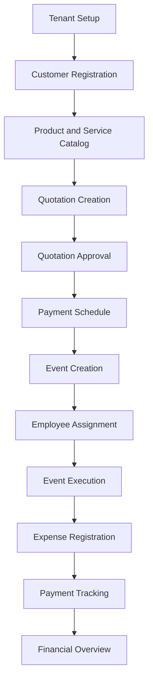

Development Roadmap
Project: CaterFlow
Document: Development Roadmap
Version: 0.2
Status: In development — backend core modules implemented; MVP incomplete
Last updated: November 20, 2026
1. Purpose
This document defines the implementation roadmap for CaterFlow.

It organizes development into milestones with clear objectives, deliverables, dependencies, and completion criteria. It also records the verified implementation status so that the roadmap reflects the actual state of the repository rather than only the initial plan.

The roadmap aims to:
- Establish a predictable development sequence.
- Prioritize foundational architecture before business features.
- Reduce implementation risks.
- Deliver working functionality incrementally.
- Validate critical business workflows early.
- Prepare the platform for production deployment.
- Keep planned functionality distinct from implemented functionality.
A milestone must only be marked as completed after all its applicable acceptance criteria have been implemented and verified. Completing one module within a milestone does not automatically complete the entire milestone.
2. Development Strategy
CaterFlow is being developed incrementally using a modular monolith architecture.

The implementation strategy follows these principles:
1. Establish the development environment and project foundation.
2. Implement authentication and tenant isolation.
3. Build shared business foundations and tenant configuration.
4. Implement customer and catalog management.
5. Implement the commercial workflow and quotations.
6. Implement event operations and workforce management.
7. Add payments, expenses, and financial reconciliation.
8. Add operational dashboards and financial reporting.
9. Complete localization, document generation, and storage.
10. Validate security and production readiness.
11. Deploy and validate the MVP with an initial catering company.
The application must remain usable and testable throughout development.
2.1 Implementation status legend
Status	Meaning
Completed	The scoped functionality has been implemented and its relevant tests have passed.
Partially completed	Some functionality is implemented, but one or more planned deliverables or acceptance criteria remain pending.
Not started	Implementation has not started.
To be verified	The roadmap does not have enough confirmed implementation evidence to mark the item complete.

The status applies to the milestone as a whole. Individual delivered components may be listed as completed inside a partially completed milestone.
3. Current Development Status
3.1 Overall status
CaterFlow currently has a working backend foundation and several core commercial modules. Authentication, application-level tenant isolation, RBAC, clients, events, products and services, and quotations have been implemented to varying degrees.

The current implementation is backend-focused. The complete frontend experience, end-to-end catering workflow, financial modules, production deployment, and initial business validation are not yet complete.
3.2 Implemented components
Area	Current implementation	Status
Backend foundation	FastAPI, SQLAlchemy 2.x, Pydantic, database session management, Alembic, and pytest setup	Completed for the current backend scope
Authentication	User authentication, password hashing, access-token handling, and refresh-token infrastructure	Implemented; full identity roadmap remains partial
Multi-tenancy	Tenant context and application-level tenant-scoped database access	Implemented
Authorization	Permission catalog, tenant roles, role-permission assignments, membership-role assignments, and permission dependencies	Implemented for the current backend scope
Clients	Tenant-scoped client CRUD, PF/PJ data, validation, search/pagination, and logical archiving	Completed for the current module scope
Events	Tenant-scoped event CRUD, client association, date and guest validation, status transitions, and cancellation	Completed for the current module scope; quote conversion and workforce remain pending
Products and services	Shared Product model differentiated by type, categories/subcategories, SKU, prices, units, search/pagination, and logical archiving	Completed for the current module scope
Quotes	Quote CRUD, sequential numbering per tenant, item management, totals, discounts, taxes, sending, and duplication	Implemented; full quotation lifecycle remains partial
Product-to-quote integration	Optional product reference, unit and commercial snapshots, negotiated prices, tenant validation, and preservation during duplication	Completed for the implemented integration scope
Automated tests	Repository, service, API, authorization, tenant-isolation, and integration tests for implemented backend modules	Implemented; full regression suite must continue to be run

3.3 Important architectural decisions
The following decisions are part of the current implementation and must be respected by future work:
- The application follows a modular monolith architecture.
- Tenant isolation is enforced at the application/backend layer using TenantSession, tenant context, ORM filtering, and authorization checks.
- PostgreSQL Row-Level Security (RLS) is deferred. It must not be reintroduced unless explicitly reconsidered.
- RBAC authorization is based on permission codes, not role names.
- A user may have multiple roles within a tenant; effective permissions are the union of the assigned roles' permissions.
- Tenant-owned relationships must preserve tenant integrity. Composite foreign keys are used where cross-tenant references must be prevented at the database level.
- Repositories do not commit transactions; transaction ownership remains in the service layer.
- Monetary values use Decimal and SQL Numeric, avoiding floating-point arithmetic for financial calculations.
- Catalog products and services may be archived logically. Historical quote items retain their commercial snapshots.
- QuoteItem.product_id is optional. Custom quote items remain supported without a catalog reference.
- Changes to a catalog product must not silently change existing quote item names, descriptions, units, or prices.
- Product and quote data must remain tenant-scoped.
- Alembic migrations are the mechanism for evolving development and production database schemas.
- The current test database fixture uses an isolated database named caterflow_test. Any destructive test-database reset must retain the explicit database-name safety check. Migration-based test database setup remains a future improvement.
3.4 Current next development focus
The next implementation work should complete the commercial-to-operational workflow before starting the financial reporting layer.

Recommended sequence:
1. Complete the quotation lifecycle needed by operations, including the approved/rejected transition and the rules required before an event can be created from an approved quotation.
2. Implement event creation/conversion from an approved quotation while preserving the approved commercial snapshot.
3. Implement workforce records, event assignments, planned/actual hours, and compensation snapshots.
4. Implement payments and expenses after the event and workforce cost model is established.
Tenant configuration items from M2 that are required by these workflows (for example, business profile, currency, timezone, and relevant defaults) should be implemented when their concrete dependencies are reached. The remaining M2 scope must not be treated as completed merely because roles and memberships already exist.
4. Milestone Overview
Milestone	Name	Priority	Current status
M0	Project Foundation	Critical	Partially completed — backend foundation implemented; frontend and full CI criteria remain to be verified
M1	Authentication and Multi-Tenancy	Critical	Partially completed — authentication, tenant isolation, and current RBAC foundation implemented; remaining identity lifecycle criteria pending
M2	Tenant Configuration and Business Foundations	High	Partially completed — role and membership foundations exist; company and operational configuration remain pending
M3	Customers and Catalog	High	Partially completed — Clients and Products/Services modules implemented; broader catalog/menu scope remains pending
M4	Pricing and Quotations	Critical	Partially completed — quote management and catalog integration implemented; approval/versioning/documents/payment terms remain pending
M5	Events and Workforce	Critical	Partially completed — Events module implemented; quote conversion and workforce management remain pending
M6	Payments and Expenses	Critical	Not started
M7	Dashboard and Financial Reporting	High	Not started
M8	Localization and Document Generation	High	Not started
M9	Security, Quality, and Production Readiness	Critical	Partially completed — automated backend tests and tenant/RBAC controls exist; formal production-readiness work remains
M10	Cloud Deployment and Initial Validation	Critical	Not started

The sequence may be adjusted when implementation reveals dependencies or risks that require a different order. Any change must be reflected in this roadmap.
5. M0 — Project Foundation
Objective: Establish the technical foundation and development environment.
Current status: Partially completed.
Scope
Backend:
- Initialize Python project.
- Configure FastAPI.
- Configure SQLAlchemy 2.x.
- Configure Alembic.
- Configure Pydantic.
- Configure Pytest.
- Establish application configuration.
- Establish database connection management.
- Configure centralized error handling.
- Establish API versioning.
Frontend:
- Initialize Next.js.
- Configure TypeScript.
- Configure Tailwind CSS.
- Configure shadcn/ui.
- Establish application layout.
- Configure environment variables.
- Establish frontend API communication structure.
Infrastructure:
- Configure Docker Compose for local development.
- Configure PostgreSQL.
- Establish development environment variables.
- Configure Git ignore rules.
- Establish initial CI pipeline.
Documentation:
- Review setup instructions.
- Document development commands.
- Document environment configuration.
Implemented
- Backend project foundation with FastAPI.
- SQLAlchemy 2.x models and database session management.
- Alembic migration setup and sequential schema migrations.
- Pydantic schemas.
- Pytest configuration and isolated PostgreSQL test database.
- Backend configuration and API versioning.
Pending / To be verified
- Frontend initialization and its acceptance criteria.
- Full local Docker Compose workflow for the application stack.
- Initial CI pipeline and automated CI validation.
- Complete centralized error-handling and setup-documentation review against the original acceptance criteria.
Deliverables
- Running FastAPI application.
- Running Next.js application.
- PostgreSQL development database.
- Initial Alembic migration setup.
- Basic frontend/backend communication.
- Initial automated tests.
- Reproducible local development environment.
Acceptance Criteria
- Backend starts successfully.
- Frontend starts successfully.
- Backend connects to PostgreSQL.
- Alembic can apply migrations.
- Frontend can communicate with the backend.
- Automated tests execute successfully.
- CI validates the initial project structure.
Dependencies: None.
6. M1 — Authentication and Multi-Tenancy
Objective: Establish secure user identity, tenant membership, and data isolation.
Current status: Partially completed.
Scope
Identity:
- User registration.
- Login.
- Password hashing.
- Access-token generation.
- Refresh-token lifecycle.
- Logout.
- Password recovery.
- Email verification where configured.
Tenant management:
- Tenant creation.
- Tenant information.
- Tenant membership.
- Tenant selection.
- Tenant switching.
- Tenant activation and deactivation.
Authorization:
- Initial RBAC implementation.
- Owner role.
- Administrator role.
- Manager role.
- Staff role.
- Finance role.
- Viewer role.
- Permission checks.
Security:
- Authentication dependencies.
- Tenant context resolution.
- Tenant-scoped database access.
- Session revocation.
- Authentication rate limiting.
Implemented
- User persistence and password hashing.
- Access-token authentication and refresh-token infrastructure.
- Tenant and membership persistence.
- Tenant context resolution for protected API access.
- Tenant-scoped sessions with ORM-level tenant filtering and write validation.
- Tenant-scoped role and membership-role assignments.
- Permission catalog and require_permission authorization dependency.
- Effective permissions based on assigned role permissions.
- Automated tests for authentication, authorization, and tenant isolation.
Pending / To be verified
- Password recovery workflow.
- Email verification workflow, if required for the selected release.
- Complete logout and refresh-token revocation behavior against the final authentication requirements.
- Tenant selection/switching user experience and complete lifecycle workflows.
- Authentication rate limiting.
- Any remaining role templates or permission-management user interfaces.
Deliverables
- Identity module.
- Tenants module.
- User and membership persistence.
- Authentication API.
- Tenant context implementation.
- Permission system.
- Security and tenant-isolation tests.
Acceptance Criteria
- Users can register and authenticate.
- Passwords are stored securely.
- Access and refresh tokens follow the authentication specification.
- Users can access only authorized active tenant memberships.
- Tenant context is resolved securely.
- Permissions are enforced by the backend.
- Cross-tenant access tests pass.
- Revoked sessions cannot be reused.
Dependencies: M0.
7. M2 — Tenant Configuration and Business Foundations
Objective: Allow each catering company to configure its business environment.
Current status: Partially completed.
Scope
Company configuration:
- Business name.
- Logo.
- Contact information.
- Address.
- Tax identification information.
- Default currency.
- Default language.
- Timezone.
- Business settings.
Operational configuration:
- Payment terms.
- Default payment conditions.
- Quotation validity period.
- Menu change deadlines.
- Basic event settings.
Users and permissions:
- Invite users.
- Manage memberships.
- Assign roles.
- Activate and deactivate users.
Infrastructure:
- Tenant-specific configuration loading.
- Initial audit logging.
- Tenant-specific branding support.
Implemented
- Tenant records and tenant membership foundations.
- Tenant roles, memberships, and permission assignments are implemented as part of the current identity/RBAC foundation.
Pending
- Tenant company profile and settings model/API.
- Company address and tax identification configuration.
- Logo and tenant branding support.
- Tenant-specific currency, language, and timezone settings.
- Business defaults for quotations and events.
- Payment-term configuration.
- User invitation and complete membership lifecycle workflows.
- Audit logging.
- Company profile and user/membership management interfaces.
Deliverables
- Tenant settings module.
- Company profile interface.
- User and membership management interface.
- Initial audit records.
- Tenant configuration API.
Acceptance Criteria
- Each tenant can configure its company information.
- Configuration is isolated between tenants.
- Tenant settings persist correctly.
- Users can be assigned authorized roles.
- Relevant configuration changes are audited.
- Default currency and timezone are applied consistently.
Dependencies: M1.
8. M3 — Customers and Catalog
Objective: Implement the basic commercial data required to prepare catering quotations.
Current status: Partially completed.
Scope
Customers:
- Customer creation.
- Customer listing.
- Customer details.
- Customer editing.
- Customer archiving.
- Customer search and filtering.
Catalog:
- Food items.
- Beverages.
- Menus.
- Menu categories.
- Item descriptions.
- Unit types.
- Base prices.
- Active/inactive status.
Data integrity:
- Tenant ownership.
- Validation.
- Historical reference preservation.
- Basic search and pagination.
Implemented
Clients module:
- Tenant-scoped client creation, listing, detail retrieval, updating, and logical archiving.
- Support for individual and business clients.
- Client contact validation, including email or phone requirements.
- Address and notes fields.
- Search and pagination.
- Tenant isolation and automated repository, service, and API tests.
Products and Services catalog:
- Shared Product model differentiated by type (product or service).
- Tenant-scoped product/service creation, listing, retrieval, updating, and logical archiving.
- Product categories and hierarchical subcategories.
- Optional category association.
- Tenant-unique SKU when supplied.
- Sale price and cost price using decimal monetary types.
- Standardized units represented by an application-level enum for the MVP.
- Search, filtering, pagination, and active/inactive filtering.
- RBAC permissions for products and product categories.
- Tenant isolation and automated repository, service, and API tests.
Pending
- Menu management and menu categories as distinct commercial concepts, if retained in the final product scope.
- Menu composition and association with products/services.
- Any additional catalog capabilities identified during business workflow validation.
- Frontend interfaces for client and catalog management.
Deliverables
- Customers module.
- Product and service catalog module.
- Category management.
- Customer management interface.
- Catalog management interface.
- Database migrations.
- Automated tests.
Acceptance Criteria
- Tenants can manage their own customers.
- Tenants can manage their own products and services.
- Catalog items can be organized by category and subcategory.
- Archived records remain available for historical references where required.
- Cross-tenant access is prevented.
- Search and pagination work correctly.
- Historical commercial records are not silently changed by catalog updates.
Dependencies: M2.
Implementation note: Core customer and product/service backend modules were implemented before all M2 configuration work was completed. The remaining M2 requirements remain open and are not implicitly considered satisfied by M3.
9. M4 — Pricing and Quotations
Objective: Implement the commercial workflow from pricing configuration to quotation approval.
Current status: Partially completed.
Scope
Pricing:
- Base item prices.
- Menu pricing.
- Quantity-based calculations.
- Event-related pricing.
- Optional additional charges.
- Configurable discounts.
Quotations:
- Quotation creation.
- Customer association.
- Event information.
- Guest count.
- Event type.
- Service format.
- Menu selection.
- Employee and service cost estimates.
- Multiple commercial proposals where appropriate.
- Quotation versions.
- Quotation PDF generation.
- Quotation approval.
- Quotation rejection.
- Quotation revision.
Payment conditions:
- Configurable payment terms.
- Percentage-based installments.
- Fixed-amount installments.
- Due date configuration.
- Payment schedule generation upon approval.
Historical integrity:
- Immutable quotation versions.
- Approval snapshot.
- Approved amount preservation.
- Approved payment terms preservation.
Implemented
- Tenant-scoped quote creation, listing, retrieval, and updating.
- Sequential quote numbering per tenant.
- Quote association with a client and optional event.
- Quote items with name, description, quantity, unit price, total price, and position.
- Decimal-based subtotal, discount, tax, and total calculations.
- Validation preventing discounts from exceeding the subtotal.
- Draft and sent workflow actions.
- Quote duplication as an independent draft with a new quote number.
- Optional association between quote items and catalog products/services through product_id.
- Catalog-derived item snapshots for name, description, unit, and initial sale price.
- Manual negotiated unit prices without changing catalog prices.
- Support for custom quote items without a catalog product reference.
- Rejection of nonexistent or cross-tenant products and rejection of archived products for new quote items.
- Preservation of quote item snapshots and product references when duplicating quotes.
- Alembic migration 11f177f93ded adding optional product_id, unit, and the composite tenant/product foreign key to quote_items.
- Automated repository, service, and API tests for the implemented quote workflows and product integration.
Pending
- Complete quote lifecycle actions, including acceptance and rejection transitions and their authorization rules.
- Define and implement quotation revision/version semantics.
- Preserve an explicit immutable approved quotation version/snapshot.
- Menu selection and menu pricing, if menus remain part of the product scope.
- Event-related pricing and richer additional-charge rules.
- Employee and service cost estimates.
- Multiple commercial proposals, if required by validated business workflows.
- Configurable payment conditions and installment generation.
- Quotation PDF generation and tenant branding.
- Tests for all remaining commercial lifecycle and financial rules.
Deliverables
- Pricing module.
- Quotations module.
- Quotation versioning.
- Quotation approval workflow.
- Initial PDF generation.
- Payment schedule generation.
- Financial calculation tests.
Acceptance Criteria
- Users can create and revise quotations.
- Pricing calculations are performed by the backend.
- Previous quotation versions remain preserved.
- Approval identifies the exact approved version.
- Payment installments reconcile with the approved amount.
- Approved commercial terms cannot be silently modified.
- Generated PDFs reflect the correct quotation version.
- All critical financial calculations pass automated tests.
Dependencies: M3.
10. M5 — Events and Workforce
Objective: Convert approved quotations into operational events and manage the employees responsible for delivery.
Current status: Partially completed.
Scope
Events:
- Event creation from approved quotations.
- Event details.
- Event scheduling.
- Event status management.
- Event updates.
- Event cancellation.
- Event history.
Initial event statuses:
- Scheduled.
- Confirmed.
- In Preparation.
- In Progress.
- Completed.
- Cancelled.
Workforce:
- Employee registration.
- Permanent employee support.
- Freelancer support.
- Employee roles.
- Event assignments.
- Planned hours.
- Actual hours.
- Hourly compensation.
- Fixed compensation per event.
- Historical compensation snapshots.
Operational management:
- Employee assignment changes.
- Assignment history.
- Event staffing overview.
- Operational notes where appropriate.
Implemented
Events module:
- Tenant-scoped event creation, listing, retrieval, and updating.
- Required association with a client.
- Optional event association in quotes.
- Event date/time validation and start-before-end rule.
- Positive guest-count validation.
- Event status management using the implemented statuses: draft, confirmed, in_progress, completed, and cancelled.
- Controlled status transitions and cancellation rules.
- Independent event address, notes, and country field (default ES).
- Client/event tenant integrity through composite foreign-key constraints.
- RBAC permissions and automated repository, service, and API tests.
Pending
- Event creation/conversion from an accepted quotation.
- Idempotency protection for quotation-to-event conversion.
- Preservation of the approved quotation snapshot in the resulting event.
- Any additional event statuses or transition rules required by the final operational workflow.
- Employee and freelancer registration.
- Employee roles and compensation configuration.
- Event employee assignments.
- Planned and actual hours.
- Hourly and fixed event compensation.
- Historical compensation snapshots.
- Assignment history and staffing overview.
- Event management and workforce interfaces.
Deliverables
- Events module completion.
- Workforce module.
- Event management interface.
- Employee management interface.
- Assignment management.
- Compensation calculation services.
Acceptance Criteria
- Approved quotations can be converted into events.
- Conversion is idempotent.
- Event information preserves the approved commercial snapshot.
- Employees can be assigned to events.
- Planned and actual hours can be recorded.
- Compensation methods work correctly.
- Historical compensation is preserved.
- Event cancellation does not automatically delete financial records.
Dependencies: M4.
Implementation note: The standalone Events backend module is implemented, but the complete event-from-approved-quote workflow and workforce scope are not.
11. M6 — Payments and Expenses
Objective: Implement financial tracking and event cost management.
Current status: Not started.
Scope
Payments:
- Payment installment tracking.
- Payment registration.
- Partial payments.
- Full payments.
- Outstanding balances.
- Overdue installments.
- Payment cancellation or reversal.
- Refund records where applicable.
Initial payment statuses:
- Pending.
- Partially Paid.
- Paid.
- Overdue.
- Cancelled.
Expenses:
- Expense registration.
- Event association.
- Expense categories.
- Expense descriptions.
- Expense dates.
- Expense amounts.
- Expense corrections and reversals.
Initial expense categories:
- Food and ingredients.
- Beverages.
- Workforce.
- Transportation.
- Other.
Financial rules:
- Preserve historical payment records.
- Preserve historical expenses.
- Avoid duplicate workforce cost recognition.
- Separate estimated costs from actual expenses.
- Separate event completion from financial settlement.
Deliverables
- Payments module.
- Expenses module.
- Payment management interface.
- Expense management interface.
- Financial reconciliation services.
- Financial calculation tests.
Acceptance Criteria
- Payments can be registered against installments.
- Partial payments update outstanding balances correctly.
- Overdue installments are identified.
- Expense records can be associated with events.
- Corrections and reversals preserve history.
- Workforce costs are not double-counted.
- Event status and payment status remain independent.
- Financial summaries reconcile with source records.
Dependencies: M5.
12. M7 — Dashboard and Financial Reporting
Objective: Provide an overview of business operations and financial performance.
Current status: Not started.
Scope
Operational dashboard:
- Upcoming events.
- Events in preparation.
- Events in progress.
- Completed events.
- Cancelled events.
- Employee allocation overview.
Financial dashboard:
- Approved quotation value.
- Payments received.
- Outstanding balances.
- Actual expenses.
- Estimated costs.
- Event financial results.
Filtering:
- Date range.
- Event status.
- Customer.
- Event type.
- Relevant financial categories.
Reporting:
- Event-level financial summaries.
- Period-based summaries.
- Payment summaries.
- Expense summaries.
- Basic operational reports.
Deliverables
- Reporting module.
- Dashboard API.
- Dashboard interface.
- Financial aggregation services.
- Reporting tests.
Acceptance Criteria
- Dashboard values match underlying records.
- Financial metrics distinguish received payments from approved revenue.
- Outstanding balances are calculated correctly.
- Event expenses are not duplicated.
- Filters return the correct tenant-scoped results.
- Reporting respects user permissions.
Dependencies: M6.
13. M8 — Localization and Document Generation
Objective: Complete the multilingual experience and professional business documents.
Current status: Not started.
Scope
Localization:
- Portuguese interface.
- Spanish interface.
- English interface.
- Language selection.
- Translation management.
- Locale-aware dates.
- Locale-aware numbers.
- Locale-aware currency formatting.
- Timezone-aware event displays.
Documents:
- Quotation PDFs.
- Company branding.
- Logo support.
- Selected document language.
- Customer information.
- Event information.
- Quotation version information.
- Payment conditions.
- Document layout consistency.
Storage:
- Production object storage integration.
- Secure document retrieval.
- Tenant-specific file access.
- Storage lifecycle handling.
Deliverables
- Complete initial localization.
- Multilingual quotation documents.
- Tenant branding in PDFs.
- Production storage adapter.
- Localization and document tests.
Acceptance Criteria
- All supported interface languages work.
- Translation keys are complete for released features.
- Dates and currency values use the selected locale.
- Tenant timezone is respected.
- PDFs use the selected language and correct branding.
- Private documents cannot be accessed by unauthorized tenants.
- Storage works independently of the selected provider.
Dependencies: M7, with localization foundations introduced earlier where necessary.
14. M9 — Security, Quality, and Production Readiness
Objective: Validate the complete application before production deployment.
Current status: Partially completed.
Scope
Security:
- Authentication review.
- Authorization review.
- Tenant-isolation review.
- API security review.
- Storage security review.
- Secrets management.
- Security headers.
- CORS configuration.
- Rate limiting.
- Dependency vulnerability checks.
Quality:
- Backend regression tests.
- Frontend regression tests.
- End-to-end tests.
- Financial reconciliation tests.
- Performance testing.
- Error handling review.
Operations:
- Structured logging.
- Monitoring.
- Backup configuration.
- Recovery procedures.
- Incident response documentation.
- Production environment configuration.
Privacy:
- Data retention review.
- Privacy-related requirements review.
- Access and deletion workflows where applicable.
- Legal and privacy review.
Implemented
- Automated backend tests across authentication, permissions, tenant isolation, repositories, services, and APIs.
- Application-level tenant isolation and RBAC enforcement.
- Validation of relevant cross-tenant relationships using composite foreign keys.
- Automated tests for critical quote calculations and catalog integration.
Pending
- Formal security review of the complete application.
- Production CORS, security headers, and rate-limiting configuration.
- Secrets-management review for production.
- Dependency vulnerability checks.
- Frontend regression and end-to-end tests.
- Financial reconciliation and performance testing after M6/M7.
- Structured logging and monitoring.
- Backup, restoration, and recovery procedures.
- Privacy/legal review and documented data-retention policies.
- Release checklist and security validation report.
Deliverables
- Security validation report.
- Automated test results.
- Production configuration.
- Backup and recovery procedures.
- Monitoring and logging setup.
- Release checklist.
Acceptance Criteria
- Critical tests pass.
- No known unresolved critical security vulnerabilities remain without an approved mitigation.
- Tenant isolation tests pass.
- Financial calculations are validated.
- Production secrets are configured securely.
- Backups are configured and restoration is tested.
- Monitoring and logging are operational.
- Privacy and legal requirements have received appropriate review.
Dependencies: M8, with security checks performed continuously throughout development.
15. M10 — Cloud Deployment and Initial Validation
Objective: Deploy CaterFlow as a cloud-hosted SaaS and validate the MVP with an initial catering company.
Current status: Not started.
Scope
Cloud infrastructure:
- Production backend deployment.
- Production frontend deployment.
- Managed PostgreSQL.
- Production object storage.
- HTTPS.
- Domain configuration.
- Environment configuration.
- Database migrations.
- Backup scheduling.
Release:
- Production build.
- Initial tenant setup.
- Owner account creation.
- Company configuration.
- Initial user onboarding.
Validation:
- Realistic business workflow testing.
- Quotation preparation.
- Quotation approval.
- Event scheduling.
- Employee assignments.
- Payment registration.
- Expense registration.
- Dashboard validation.
Feedback:
- Collect initial user feedback.
- Identify usability problems.
- Identify missing workflows.
- Prioritize corrections.
- Document lessons learned.
Deliverables
- Deployed CaterFlow MVP.
- Production database.
- Production storage.
- Initial tenant configured.
- Initial users onboarded.
- Operational monitoring.
- Initial validation report.
Acceptance Criteria
- Application is accessible through its production domain.
- HTTPS works.
- Authentication and tenant isolation work in production.
- Database migrations complete successfully.
- Files can be uploaded and retrieved securely.
- Critical business workflows work end to end.
- Backups and monitoring are operational.
- Initial catering company can use the application for controlled validation.
Dependencies: M9.
16. MVP Release Definition
The MVP is considered functionally complete when the following workflow works end to end:

The current backend supports important parts of the early commercial workflow: tenant-scoped client registration, product/service catalog management, quote creation and management, and a standalone event module. The complete workflow above is not yet implemented end to end.

The MVP must allow a catering company to manage its basic commercial, operational, and financial workflows without relying exclusively on external spreadsheets or paper records.

The MVP does not require a public marketplace, customer portal, integrated payment gateway, native mobile application, advanced inventory management, or AI functionality.
Current MVP gaps
- Complete tenant/company configuration.
- Complete quotation approval and revision/versioning workflow.
- Event creation from an approved quotation.
- Workforce registration, assignments, and compensation.
- Payment schedules, payment tracking, and expenses.
- Operational and financial dashboards.
- Localization, quotation documents, and production storage.
- Production-readiness validation and deployment.
- Initial real-business validation.
17. Prioritization Strategy
Features must be prioritized according to:
1. Security and data integrity.
2. Dependencies between modules.
3. Core business value.
4. Operational usability.
5. Implementation complexity.
6. Validation opportunities.
A feature must not be prioritized only because it is visually attractive or easy to implement.
17.1 Immediate implementation sequence
Based on the current repository state, the recommended near-term sequence is:
1. Complete the quotation lifecycle needed for approval and event conversion.
2. Implement the approved-quotation-to-event workflow, including idempotency and commercial snapshot preservation.
3. Implement workforce and event assignments, including historical compensation snapshots.
4. Implement payment installments, payments, and expenses.
5. Implement operational and financial reporting.
6. Complete tenant settings, localization, document generation, and production requirements where they are dependencies for release.
This execution sequence may bring forward selected M2 or M8 requirements when required by a concrete business workflow. It does not change the acceptance criteria of those milestones.
18. Milestone Management
Each milestone must have:
- Defined scope.
- Clear dependencies.
- Implementation tasks.
- Automated tests.
- Acceptance criteria.
- Documentation updates.
- Review before completion.
Milestones may be divided into smaller implementation tasks.

A milestone must not be considered complete simply because its main interface exists.

Backend behavior, data integrity, permissions, tests, and relevant documentation must also be complete.
18.1 Definition of Done
A feature or milestone is considered complete only after all applicable stages have been verified:
1. Implementation.
2. Automated tests.
3. Validation of relevant relationships, constraints, and tenant boundaries.
4. Documentation update.
5. Code-quality checks.
6. Manual/API verification where applicable.
7. Commit.
A passing test suite is necessary but does not, by itself, prove that unimplemented scope or production acceptance criteria are complete.
18.2 Documentation maintenance
After completing a meaningful module or integration:
- Update this roadmap with the actual implementation status.
- Update MVP_SCOPE.md when delivered scope changes.
- Update BUSINESS_RULES.md when business behavior or constraints change.
- Update USER_FLOWS.md when a workflow becomes available or changes.
- Update architecture/database documentation when models, relationships, or infrastructure decisions change.
- Record notable delivered changes in the changelog, if maintained.
19. Future Improvements After MVP
The following capabilities are outside the initial MVP and may be evaluated later:
- Customer portal.
- Public catering marketplace.
- Online booking and quote requests.
- Integrated payment gateways.
- WhatsApp integration.
- Advanced inventory management.
- Ingredient-level recipe costing.
- Native mobile applications.
- Advanced analytics.
- AI-assisted quotation preparation.
- Advanced workforce scheduling.
- Multi-currency financial reporting.
- Additional third-party integrations.
Future features must follow the same modular architecture and tenant-isolation requirements.
20. Open Decisions
Decision	Status
Cloud hosting provider	To be selected
Production database provider	To be selected
Object storage provider	To be selected
Email provider	To be selected
PDF generation technology	To be selected
CI/CD provider	To be selected
Monitoring provider	To be selected
Initial production domain	To be defined
Initial pilot onboarding process	To be defined
MVP release date	To be defined
Final tenant configuration fields and defaults	To be validated against business workflows
Final quote approval and revision rules	To be defined and implemented
Workforce compensation rules	To be validated before implementation

21. Final Principles
CaterFlow must be developed incrementally, validating each milestone before moving to the next.

The priority is not to build every possible feature as quickly as possible, but to deliver a secure, reliable, and useful product that solves real catering business problems.

The current implementation is a backend foundation with working commercial modules, not yet a complete production-ready MVP. The next major objective is to connect quotations to event operations and then implement workforce, payments, expenses, and reporting.

The initial production release must focus on the complete commercial-to-operational-to-financial workflow.

End of document.