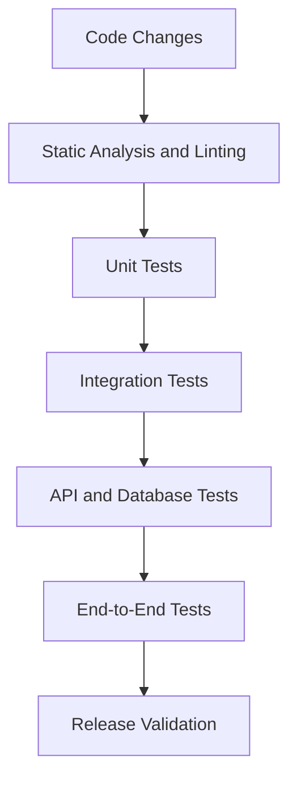
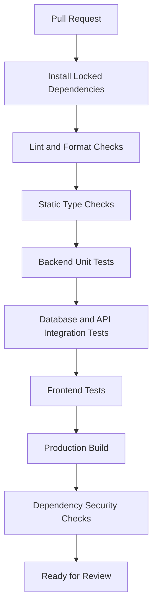

# Testing Strategy

**Project:** CaterFlow  
**Document:** Testing Strategy  
**Version:** 0.1  
**Status:** Initial specification  
**Last updated:** November 2026

---

## 1. Purpose

This document defines the testing strategy, quality standards, and validation procedures for the CaterFlow platform.

The main objectives are:

- Ensure application correctness and reliability.
- Prevent regressions when new features are introduced.
- Validate business rules and financial calculations.
- Guarantee tenant isolation.
- Verify authentication and authorization.
- Validate API contracts and database operations.
- Ensure consistent frontend behavior.
- Reduce production defects.

Testing must be part of the development lifecycle rather than a final activity performed only before release.

## 2. Testing Principles

CaterFlow testing must follow these principles:

### 2.1 Test Critical Business Rules

Every important business rule must have automated tests.

Financial calculations, quotation approvals, event conversions, payment schedules, and employee compensation require particular attention.

### 2.2 Tenant Isolation Is Mandatory

Every feature that accesses tenant-owned information must be tested for cross-tenant access.

A successful request from one tenant must never expose another tenant's data.

### 2.3 Test Expected and Unexpected Scenarios

Tests must cover:

- Successful operations.
- Invalid input.
- Missing resources.
- Unauthorized operations.
- Conflicting operations.
- Boundary conditions.
- Unexpected failures.

### 2.4 Independent and Repeatable Tests

Tests must produce predictable results regardless of execution order.

They must not depend on manually created data or external production services.

### 2.5 Test at the Appropriate Level

Use unit tests for isolated logic, integration tests for interactions between components, and end-to-end tests for complete user workflows.

## 3. Testing Levels

The testing strategy will use the following levels:



### 3.1 Unit Tests

Unit tests validate individual functions, classes, and business rules without requiring the complete application infrastructure.

Examples:

- Quotation total calculations.
- Discount calculations.
- Payment installment generation.
- Employee compensation calculations.
- Event financial summaries.
- Date and deadline validation.
- Currency rounding.

Unit tests should be fast and independent.

External dependencies should be mocked when appropriate.

### 3.2 Integration Tests

Integration tests validate interactions between application components.

Examples:

- Service and repository interactions.
- Database transactions.
- Customer creation and persistence.
- Quotation version creation.
- Event conversion.
- Payment registration.
- Expense registration.
- Storage adapter integration.

Integration tests should use controlled test dependencies and isolated data.

### 3.3 API Tests

API tests validate HTTP endpoints through the FastAPI application.

They must verify:

- HTTP status codes.
- Request validation.
- Response structures.
- Authentication requirements.
- Authorization requirements.
- Tenant context validation.
- Error responses.
- Pagination.
- Filtering and sorting.
- Business rule enforcement.

### 3.4 Database Tests

Database tests validate persistence behavior and database-level constraints.

They must cover:

- Primary and foreign keys.
- Unique constraints.
- Tenant-scoped relationships.
- Transactions and rollbacks.
- Numeric precision.
- Index-dependent query behavior where relevant.
- Migrations.
- Soft deletion and historical preservation.

PostgreSQL must be used for integration tests that depend on PostgreSQL-specific behavior.

SQLite may be used for isolated tests only when its behavior is equivalent for the functionality being tested.

### 3.5 Frontend Tests

Frontend tests validate components and feature behavior.

They must cover:

- Form validation.
- User interactions.
- Dialogs and confirmation flows.
- Loading states.
- Empty states.
- Error states.
- API integration behavior.
- Permission-dependent interface behavior.
- Localization.

### 3.6 End-to-End Tests

End-to-end tests validate complete business workflows from the user's perspective.

They should cover the most important operational processes before production releases.

## 4. Backend Testing Strategy

The backend will use Pytest.

Recommended supporting tools:

- HTTPX for API testing.
- FastAPI TestClient where appropriate.
- SQLAlchemy test sessions.
- PostgreSQL test database.
- Coverage reporting.
- Factory or fixture utilities for test data.

### 4.1 Suggested Test Organization

```text
backend/
└── tests/
    ├── conftest.py
    ├── unit/
    │   ├── customers/
    │   ├── quotations/
    │   ├── payments/
    │   └── workforce/
    ├── integration/
    │   ├── database/
    │   ├── services/
    │   └── storage/
    ├── api/
    │   ├── customers/
    │   ├── quotations/
    │   ├── events/
    │   └── payments/
    ├── security/
    │   ├── authentication/
    │   ├── authorization/
    │   └── tenant_isolation/
    └── e2e/
```

The exact organization may evolve as the number of modules grows.

### 4.2 Fixtures

Shared fixtures should provide:

- Test database connection.
- Database session.
- FastAPI test client.
- Authenticated user.
- Tenant A.
- Tenant B.
- Tenant membership.
- Users with different roles.
- Sample customers.
- Sample employees.
- Sample catalog items.
- Sample quotations and events.

Fixtures must isolate test data and clean up after execution.

### 4.3 Database Isolation

Tests must not modify production data.

Each test run must use a dedicated test database or an equivalent isolated database environment.

Database transactions and cleanup procedures must prevent test data from leaking between tests.

Tests that require multiple independent database connections or concurrent transactions must be designed to validate actual PostgreSQL behavior.

## 5. Multi-Tenant Isolation Testing

Tenant isolation is a mandatory release requirement.

The test environment must contain at least two independent tenants.

Example:

- Tenant A: Catering Company A.
- Tenant B: Catering Company B.
- User A: Member of Tenant A.
- User B: Member of Tenant B.

Tests must verify that Tenant A cannot access Tenant B resources.

### 5.1 Read Protection

- User A cannot list Tenant B customers.
- User A cannot retrieve Tenant B quotations.
- User A cannot retrieve Tenant B events.
- User A cannot access Tenant B employees.
- User A cannot access Tenant B financial records.
- User A cannot download Tenant B files.

### 5.2 Write Protection

- User A cannot modify Tenant B customers.
- User A cannot modify Tenant B quotations.
- User A cannot modify Tenant B events.
- User A cannot modify Tenant B payment records.
- User A cannot modify Tenant B expenses.

### 5.3 Delete Protection

- User A cannot delete Tenant B resources.
- User A cannot archive Tenant B records.
- User A cannot cancel Tenant B events.

### 5.4 Relationship Protection

The database and application must reject cross-tenant relationships.

Examples:

- A quotation from Tenant A cannot reference a customer from Tenant B.
- An event from Tenant A cannot reference a quotation from Tenant B.
- An employee assignment from Tenant A cannot reference an employee from Tenant B.
- An expense from Tenant A cannot reference an event from Tenant B.

### 5.5 Context Manipulation

Tests must verify that:

- Changing `tenant_id` in a request does not bypass authorization.
- Guessing or obtaining another tenant's UUID does not grant access.
- Switching tenant context requires valid membership.
- Inactive memberships cannot access tenant resources.
- Background jobs cannot execute with an unauthorized tenant context.

### 5.6 Required Result

<badge color="danger">Release blocker</badge>

Any confirmed cross-tenant data exposure or unauthorized cross-tenant modification must block release.

## 6. Authentication and Authorization Testing

Authentication tests must validate the rules defined in `AUTHENTICATION.md`.

Scenarios:

- Valid login.
- Invalid login.
- Incorrect password.
- Expired access token.
- Invalid token signature.
- Revoked refresh token.
- Refresh token rotation.
- Refresh token reuse detection.
- Password recovery.
- Inactive account.
- Inactive tenant membership.
- Session revocation.
- Rate limiting on authentication endpoints.

Authorization tests must validate the configured roles and permissions.

Example scenarios:

- Staff cannot perform administrative actions.
- Finance users cannot modify unrelated tenant settings.
- Viewers cannot modify business records.
- Managers can only execute actions allowed by their permissions.
- Tenant administrators cannot access platform-level administration.

The test suite must verify backend permissions independently of frontend visibility.

## 7. Financial Testing

Financial correctness is critical to CaterFlow.

All monetary calculations must use `Decimal` and be tested with representative values and edge cases.

### 7.1 Quotation Calculations

Test:

- Item quantities and unit prices.
- Subtotals.
- Discounts.
- Additional charges.
- Taxes, if and when supported.
- Final quotation total.
- Decimal precision.
- Rounding behavior.

### 7.2 Quotation Versioning

Test:

- Creating a new quotation version.
- Preserving previous versions.
- Approving a specific version.
- Preventing approval from silently changing the approved amount.
- Preserving the approved commercial snapshot.
- Creating a new version after relevant modifications.

### 7.3 Payment Schedules

Test:

- Percentage-based installments.
- Fixed-amount installments.
- Installment totals matching the quotation amount.
- Rejection of percentage schedules that do not total exactly 100%.
- Reconciliation of fixed amounts with the approved amount.
- Due date generation.
- Preservation of payment terms after quotation approval.

### 7.4 Payment Registration

Test:

- Full payment.
- Partial payment.
- Multiple payments against an installment.
- Overpayment handling.
- Duplicate payment prevention.
- Payment cancellation or reversal.
- Outstanding balance calculations.
- Payment status transitions.

### 7.5 Employee Compensation

Test:

- Hourly compensation.
- Fixed compensation per event.
- Planned hours.
- Actual hours.
- Compensation snapshots.
- Changes to employee rates after an assignment is created.
- Correct historical compensation preservation.

### 7.6 Expense Calculations

Test:

- Expense creation.
- Expense categories.
- Event-associated expenses.
- General expenses where supported.
- Expense corrections.
- Expense cancellation or reversal.
- Total expense aggregation.
- Prevention of duplicate staff cost recognition.

### 7.7 Financial Summary

Test that the application correctly distinguishes:

- Approved quotation value.
- Amount received.
- Outstanding balance.
- Actual expenses.
- Estimated costs.
- Actual financial result.

Event completion must not automatically imply that all payments have been received.

## 8. Quotation and Event Workflow Testing

The following workflows must be tested.

### 8.1 Quotation Creation

- Create a quotation for an existing customer.
- Add catalog items.
- Apply pricing rules.
- Generate totals.
- Save the quotation.
- Generate a PDF.
- Verify that the document uses the correct tenant branding and language.

### 8.2 Quotation Approval

- Approve the current quotation version.
- Preserve approval date and user.
- Prevent silent changes to the approved version.
- Generate the configured payment schedule.
- Preserve the approved commercial terms.

### 8.3 Event Conversion

- Convert an approved quotation into an event.
- Preserve relevant quotation information.
- Preserve the approved amount.
- Avoid duplicate event creation.
- Verify that conversion is idempotent.

### 8.4 Event Management

- Schedule an event.
- Assign employees.
- Register planned hours.
- Update event status.
- Register actual hours.
- Register expenses.
- Complete the event.
- Review financial results.

### 8.5 Event Cancellation

- Cancel an event.
- Preserve historical information.
- Preserve existing payment records.
- Preserve existing expenses.
- Register refunds or reversals explicitly when necessary.
- Verify the resulting financial status.

## 9. Workforce Testing

The workforce module must support permanent employees and freelancers.

Tests must cover:

- Employee creation.
- Employee updates.
- Employee deactivation.
- Employee assignment to events.
- Assignment conflicts where applicable.
- Role assignment within an event.
- Planned hours.
- Actual hours.
- Compensation methods.
- Historical compensation snapshots.
- Employee access permissions.

The application must preserve historical event assignments when employee information changes.

## 10. Storage Testing

Storage tests must validate the abstraction defined in `STORAGE.md`.

Scenarios:

- Upload a valid file.
- Reject an unsupported file type.
- Reject oversized files.
- Generate unique internal file identifiers.
- Verify tenant ownership.
- Download an authorized file.
- Reject unauthorized downloads.
- Delete or archive a file according to retention rules.
- Handle missing files.
- Handle storage provider failures.
- Prevent path traversal.
- Verify that private files are not publicly accessible.

Both local development storage and the selected production storage adapter must be tested.

## 11. Frontend Testing Strategy

The frontend will use a component and end-to-end testing framework.

Recommended tools:

- Vitest.
- React Testing Library.
- Playwright.

The final selection and versions will be defined during frontend setup.

### 11.1 Component Tests

Test reusable components such as:

- Buttons.
- Dialogs.
- Tables.
- Forms.
- Select fields.
- Date pickers.
- Status indicators.
- Currency displays.
- Navigation elements.

### 11.2 Feature Tests

Test important feature behavior:

- Customer creation and editing.
- Catalog item management.
- Quotation creation.
- Quotation version display.
- Event scheduling.
- Employee assignment.
- Payment registration.
- Expense registration.
- Dashboard filtering.

### 11.3 UI States

Every major feature should be tested for:

- Loading.
- Success.
- Empty results.
- Validation errors.
- API errors.
- Permission restrictions.
- Responsive behavior where relevant.

### 11.4 Localization

Test:

- Portuguese translations.
- Spanish translations.
- English translations.
- Date formatting.
- Number formatting.
- Currency formatting.
- Timezone-sensitive displays.
- Language selection for generated documents where applicable.

## 12. End-to-End Testing

End-to-end tests must validate critical user workflows through the actual frontend and backend.

Initial scenarios:

### E2E-001: Tenant Onboarding

1. Create a tenant.
2. Register its owner.
3. Configure company information.
4. Configure language and timezone.
5. Verify access to the tenant dashboard.

### E2E-002: Customer and Catalog Setup

1. Create a customer.
2. Register catalog items.
3. Configure relevant prices.
4. Verify that the information is available for quotations.

### E2E-003: Quotation to Event

1. Create a quotation.
2. Generate its PDF.
3. Approve a specific quotation version.
4. Verify the payment schedule.
5. Convert the quotation into an event.
6. Verify that no duplicate event is created.

### E2E-004: Event Operations

1. Open an event.
2. Assign employees.
3. Register planned hours.
4. Update the event status.
5. Register actual hours.
6. Add expenses.
7. Complete the event.

### E2E-005: Financial Reconciliation

1. Register a partial payment.
2. Register another payment.
3. Verify the outstanding balance.
4. Verify payment status.
5. Compare approved revenue with actual expenses.
6. Verify the final financial summary.

### E2E-006: Tenant Isolation

1. Create two independent tenants.
2. Create separate users.
3. Create business records for each tenant.
4. Attempt to access Tenant B data using Tenant A credentials.
5. Verify that all unauthorized operations are rejected.

### E2E-007: Cancellation and Reversal

1. Create and approve a quotation.
2. Convert it into an event.
3. Register a payment and an expense.
4. Cancel the event.
5. Verify that historical financial records remain available.
6. Register explicit reversals where appropriate.
7. Verify the resulting financial summary.

## 13. Test Data Management

Test data must be predictable, isolated, and reproducible.

Requirements:

- Use factories or fixtures for repeated entities.
- Avoid depending on production data.
- Use representative financial values.
- Include different tenant configurations.
- Include users with different roles.
- Include both permanent employees and freelancers.
- Include events in different operational states.
- Include quotations with different payment conditions.
- Include partial and fully paid invoices or installments where applicable.

Sensitive production information must never be copied into the test environment without an approved anonymization process.

## 14. Test Environment

The development and testing environments must be separated from production.

The testing environment should include:

- Dedicated PostgreSQL database.
- Backend test configuration.
- Frontend test configuration.
- Isolated storage.
- Test authentication configuration.
- Mock or sandbox external integrations.

Tests must not send real customer emails, process real payments, or modify production files.

External services should use mocks or approved sandbox environments.

## 15. Code Coverage

Coverage reports should help identify untested critical logic.

Initial targets:

| Area | Initial target |
|---|---:|
| Backend overall | 80% |
| Financial calculations | 95% |
| Tenant isolation and authorization | 95% |
| Critical application services | 90% |
| Frontend feature logic | 80% |

These are initial engineering targets, not substitutes for meaningful test cases.

A high coverage percentage does not guarantee correctness.

Critical security and financial scenarios must be tested explicitly, even when overall coverage is already high.

## 16. Continuous Integration

CI must execute automated checks for every relevant change.

Recommended pipeline:



The pipeline must fail when mandatory checks fail.

Production deployment must not proceed when critical tests are failing.

## 17. Test Execution Commands

The following commands represent the intended testing interface.

Exact scripts and configuration will be created during implementation.

### Backend

```powershell
# Run all backend tests
pytest

# Run unit tests
pytest tests/unit

# Run integration tests
pytest tests/integration

# Run API tests
pytest tests/api

# Run security tests
pytest tests/security

# Generate coverage report
pytest --cov=app --cov-report=term-missing
```

### Frontend

```powershell
# Run frontend tests
npm test

# Run tests in CI mode
npm run test:ci

# Run lint checks
npm run lint

# Run TypeScript checks
npx tsc --noEmit

# Build the production application
npm run build
```

These commands are proposed conventions. Their availability depends on the scripts and dependencies configured during project setup.

## 18. Release Quality Gates

A release must not proceed when any of the following conditions apply:

- Critical backend tests are failing.
- Critical frontend tests are failing.
- Tenant isolation tests are failing.
- Authorization tests reveal unauthorized access.
- Financial calculations produce incorrect results.
- Database migrations are invalid or unverified.
- Production build fails.
- Critical security vulnerabilities remain unresolved without an approved mitigation.

All release-blocking defects must be addressed or explicitly evaluated before deployment.

## 19. Open Decisions

The following decisions remain open:

| Decision | Status |
|---|---|
| PostgreSQL test database strategy | To be defined |
| Database cleanup and transaction strategy | To be defined |
| Frontend testing framework | Recommended: Vitest and React Testing Library |
| End-to-end framework | Recommended: Playwright |
| CI provider | To be selected |
| Coverage reporting integration | To be selected |
| Security scanning tools | To be selected |
| Test execution parallelization | To be evaluated |
| Production smoke test strategy | To be defined |

## 20. Final Principles

Testing is a fundamental part of CaterFlow development.

Every critical feature must include automated tests that validate both expected behavior and failure scenarios.

Tenant isolation, authentication, authorization, financial correctness, and historical data preservation are mandatory quality requirements.

The project must prioritize meaningful tests over coverage percentages alone.

**End of document.**