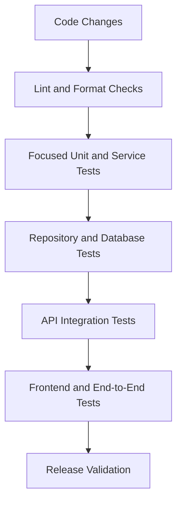
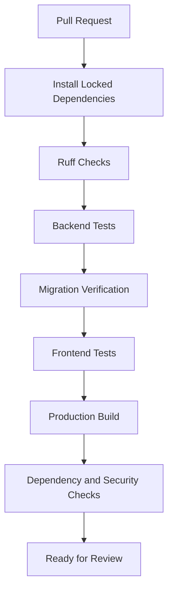

CaterFlow — Testing Strategy
Project: CaterFlow
Document: Testing Strategy
Version: 0.2
Status: Implementation-aligned strategy
Last updated: November 2026
1. Purpose
This document defines the testing strategy, quality standards, and validation procedures for CaterFlow. It distinguishes practices already implemented in the backend from requirements that remain planned for later modules and frontend development.

The main objectives are to:
- Ensure application correctness and reliability.
- Prevent regressions as features are introduced.
- Validate business rules and financial calculations.
- Protect tenant data isolation.
- Verify authentication and authorization.
- Validate API contracts, persistence behavior, and database constraints.
- Build confidence in critical workflows before release.
Testing is part of the development lifecycle, not a final activity performed only before deployment.
2. Testing Principles
2.1 Test implemented behavior and planned behavior separately
Tests must describe behavior that exists in the application. Planned capabilities must not be represented as implemented merely because they appear in product requirements. As modules are delivered, their acceptance criteria and tests should be added incrementally.
2.2 Tenant isolation is mandatory
Every feature that accesses tenant-owned information must be tested for cross-tenant access. A successful request from one tenant must never expose or modify another tenant's data.
2.3 Test success and failure paths
Tests should cover successful operations, invalid input, missing resources, insufficient permissions, conflicting operations, boundary conditions, and unexpected failures.
2.4 Independent and repeatable tests
Tests must produce predictable results regardless of execution order. They must not depend on manually created data or production services.
2.5 Test at the appropriate level
Use focused unit tests for isolated logic, service/repository tests for application behavior and persistence, API tests for HTTP contracts, and end-to-end tests for complete user workflows when the frontend is available.
3. Testing Levels and Current Coverage
CaterFlow uses a layered testing strategy:

The backend currently has automated Pytest coverage across repositories, services, and API endpoints. Frontend component tests and browser-based end-to-end tests remain planned until the frontend implementation is available.
3.1 Unit and service tests
These tests validate business rules and use-case behavior without exercising the complete HTTP stack. Depending on the behavior, they may use the isolated test database and real repositories rather than mocks.

Implemented areas include:
- Client data validation and lifecycle rules.
- Event date, guest-count, client, and status-transition rules.
- Product and product-category validation and lifecycle rules.
- Quote item resolution, totals, catalog defaults, negotiated prices, and duplication snapshots.
- Permission catalog and authorization-related behavior.
Planned areas include payment schedules, payment reconciliation, workforce compensation, expense calculations, and broader financial reporting.
3.2 Repository and database integration tests
Repository tests validate SQLAlchemy persistence behavior, tenant-scoped access, relationships, and database constraints using PostgreSQL.

Implemented coverage includes:
- Client, event, product, product-category, and quote persistence.
- Tenant-aware relationships and composite foreign keys.
- Product SKU uniqueness within a tenant.
- Quote number uniqueness within a tenant.
- Product-category hierarchy constraints.
- Quote item references to catalog products.
- Transaction rollback behavior through the test session setup.
PostgreSQL is required for tests that depend on PostgreSQL-specific behavior or database constraints. SQLite should not replace PostgreSQL for those tests.
3.3 API tests
API tests exercise the FastAPI application and verify:
- HTTP status codes and response schemas.
- Request validation.
- Authentication and permission requirements.
- Tenant context enforcement.
- Resource-not-found and conflict behavior.
- Business-rule enforcement at the HTTP boundary.
Implemented endpoint coverage includes authentication/authorization foundations and the Clients, Events, Products, Product Categories, and Quotes modules.
3.4 Frontend tests
Frontend tests are planned. The intended coverage includes form validation, user interactions, loading and empty states, API errors, permission-aware navigation, responsive behavior, and localization.

The final framework and scripts must be confirmed when frontend testing is configured. Vitest, React Testing Library, and Playwright remain candidate tools, not established project dependencies.
3.5 End-to-end tests
Browser-based end-to-end tests are not yet part of the current implemented test suite. They should be introduced after the frontend and complete user workflows are available.
4. Backend Testing Tools and Conventions
The backend uses:
- Pytest for automated tests.
- FastAPI and its test client / HTTPX-compatible testing facilities for endpoint tests.
- SQLAlchemy 2.x for ORM and database integration tests.
- PostgreSQL for the isolated test database.
- uv for dependency and command execution.
Ruff is used by the development workflow for linting and formatting checks. Static type checking and coverage reporting may be added as explicit CI gates when configured; they are not assumed to be active solely because they are listed in this strategy.
5. Current Backend Test Organization
The current test suite is organized primarily by module and test type in the backend/tests/ directory. The exact file layout may evolve as the project grows; avoid creating empty directory structures solely to match a proposed diagram.

The current organization includes module-specific test files for repositories, services, and API endpoints, along with shared fixtures in tests/conftest.py.

A future organization may introduce explicit unit/, integration/, api/, and security/ subdirectories when that separation improves discoverability. Moving tests is not required for the current strategy to be valid.
6. Shared Fixtures and Test Data
Shared fixtures are defined in backend/tests/conftest.py. The test setup provides a dedicated database session and application dependencies suitable for isolated tests.

Test data should be created through fixtures or explicit test setup. Use separate tenant records and memberships when validating tenant boundaries. Prefer small, focused datasets over large shared fixtures with hidden dependencies.

As additional modules are implemented, shared factories or fixtures may be introduced for:
- Users and tenants.
- Tenant memberships and role assignments.
- Clients and events.
- Products and product categories.
- Quotes and quote items.
- Future employees, payments, expenses, and file metadata.
Fixtures must not rely on production data or real external services.
7. Test Database Isolation
7.1 Dedicated PostgreSQL database
Backend integration tests use a dedicated PostgreSQL database configured through TEST_DATABASE_URL. The test configuration validates that the target database has the expected test database name (caterflow_test) before destructive schema setup is performed.

The test fixture currently prepares the schema using SQLAlchemy metadata (drop_all() followed by create_all()) and uses an outer transaction with a session configured for savepoints (join_transaction_mode="create_savepoint"). This provides repeatable test setup and rollback isolation for the current test architecture.

Important: This schema reset is confined to the test fixture and the dedicated test database. It is not an application startup procedure and must never be used against development, staging, or production databases containing data that must be preserved.
7.2 Migrations
Production and persistent environments must be changed through Alembic migrations. The current test fixture creates its schema from Base.metadata; it does not yet validate the full Alembic migration chain on every test run.

A separate migration verification step should be added to CI. It should create a clean temporary database, apply migrations from the base revision to head, and verify that the resulting schema is usable. Migration tests must not weaken the test database name safety check.
7.3 PostgreSQL behavior
Use PostgreSQL for composite foreign keys, transaction behavior, uniqueness constraints, tenant-scoped relationships, and any query behavior that depends on PostgreSQL semantics. Do not treat SQLite results as equivalent for these cases.
8. Multi-Tenant Isolation Testing
Tenant isolation is a mandatory release requirement. Tests must use at least two independent tenants and verify that records cannot be read or modified across tenant boundaries.

The current architecture uses application-level tenant isolation through TenantSession, ORM query criteria, tenant-aware service operations, and database constraints. PostgreSQL Row-Level Security (RLS) has been explicitly deferred and is not part of the current enforcement model.
8.1 Read protection
Tests should verify that a tenant cannot list or retrieve another tenant's clients, events, products, product categories, quotes, quote items, or other tenant-owned resources as those modules are added.
8.2 Write and lifecycle protection
Tests should verify that a tenant cannot create relationships to another tenant's records, update another tenant's records, or archive/cancel resources belonging to another tenant.
8.3 Relationship protection
Composite foreign keys and application validation must prevent cross-tenant associations. Implemented examples include:
- A quote cannot reference a client from another tenant.
- An event cannot reference a client from another tenant.
- A quote cannot reference an event from another tenant.
- A quote item linked to a catalog product cannot reference a product from another tenant.
- A product cannot reference a category from another tenant.
As more modules are implemented, equivalent tests must cover workforce assignments, payments, expenses, and file metadata.
8.4 Context manipulation
Tests must verify that:
- A tenant identifier supplied by a client cannot bypass membership validation.
- Knowing another tenant's UUID does not grant access.
- Switching the active tenant requires valid membership.
- Inactive or unauthorized memberships cannot access tenant resources.
- Tenant-scoped sessions do not permit access outside their assigned tenant.
- Background jobs, when introduced, establish an explicit authorized tenant context.
8.5 Release requirement
Any confirmed cross-tenant data exposure or unauthorized cross-tenant modification is a release blocker.
9. Authentication and Authorization Testing
Authentication and authorization tests must reflect the implemented token and permission model documented in AUTHENTICATION.md and SECURITY.md.

Tests should cover, where implemented:
- Valid and invalid login credentials.
- Invalid, malformed, and expired access tokens.
- Refresh-token lifecycle and revocation behavior.
- Inactive user or membership behavior.
- Tenant membership validation.
- Permission checks for protected operations.
- Users with multiple roles and the union of their effective permissions.
- Owner-specific role and permission administration capabilities.
- Denial of operations when a permission is absent.
Do not add tests for refresh-token rotation, reuse detection, password recovery, rate limiting, or session revocation until those capabilities exist in the application. Add them as acceptance criteria when the corresponding functionality is implemented.

Authorization must be tested at the backend boundary. Hiding a button or page in the frontend is not an authorization control.
10. Financial and Commercial Testing
All monetary calculations must use Decimal and be tested with representative values and edge cases. The current implementation includes quote totals and quote item pricing; the broader financial workflows below remain future scope unless explicitly implemented in a subsequent module.
10.1 Implemented quotation coverage
Tests should validate:
- Item quantity and unit price calculations.
- Subtotal, discount, tax, and total calculations supported by the current quote model.
- Decimal precision and rounding behavior.
- Manual quote items.
- Quote items linked to catalog products.
- Default item name, description, unit, and sale price from the catalog.
- Negotiated prices that differ from catalog sale prices.
- Rejection of nonexistent, cross-tenant, or archived catalog products.
- Snapshot preservation when a product is later changed or archived.
- Quote duplication with a new quote number and preserved item snapshots.
10.2 Future quotation versioning and approval
The current quote workflow does not yet implement persisted quotation versions or a separate approval record. Quote statuses such as accepted must not be interpreted as proof that a complete approval/versioning workflow exists.

When versioning and approval are implemented, tests must cover version immutability, approval identity and timestamp, approved commercial snapshots, and creation of a new version after changes that require it.
10.3 Future payments and reconciliation
When the Payments module is implemented, test installment generation, percentage and fixed-amount schedules, partial and full payments, overpayments, duplicate transaction prevention, reversals, outstanding balances, and payment status transitions.
10.4 Future workforce and expenses
When these modules are implemented, test compensation snapshots, planned versus actual hours, expense corrections and reversals, aggregation, and prevention of duplicate cost recognition.
10.5 Future financial summaries
Reporting tests must distinguish approved commercial value, received payments, outstanding balances, estimated costs, actual expenses, and actual financial result. Event completion must not imply that all payments have been received.
11. Clients, Products, Quotes, and Events Workflow Testing
The current backend supports core CRUD and business operations for Clients, Events, Products, Product Categories, and Quotes. Tests should validate the implemented flows without assuming that unimplemented workflows are already available.
11.1 Clients
Test customer creation and updates, PF/PJ validation, required contact information rules, tenant isolation, and soft-archive behavior. Archived clients must not be treated as active choices for new business operations where the service rules require an active client.
11.2 Products and product categories
Test product/service creation, updates, activation state, category hierarchy, tenant-scoped SKU uniqueness, category ownership, and archive restrictions. A category must not be archived while it still has products or child categories when the service rule prohibits it.
11.3 Quotes
Test quote creation, retrieval, updates, sending, and duplication. Verify tenant-scoped quote numbering, client/event associations, item calculations, catalog item resolution, and historical item snapshots.
11.4 Events
Test event creation and retrieval, active client validation, date ordering, positive guest count, tenant-aware client association, and allowed status transitions. Verify that invalid transitions are rejected and that cancellation does not bypass the event lifecycle rules.
11.5 Future quote-to-event conversion
A dedicated approved-quote-to-event conversion workflow, including idempotency and preservation of an approved quote version, is not currently implemented. Add integration and end-to-end tests when that workflow is delivered.
12. Storage Testing
The storage abstraction and production object-storage integration remain planned. When implemented, tests should validate:
- Upload and retrieval of valid files.
- File size and type validation.
- Unique internal file identifiers.
- Tenant ownership and authorization.
- Unauthorized download rejection.
- Deletion or retention behavior.
- Missing-file handling.
- Provider failures and retry behavior.
- Path traversal prevention.
- Private-file access controls.
Use a local test adapter or a controlled provider sandbox. Never use production files in automated tests.
13. Frontend Testing Strategy
Frontend testing will be defined when the Next.js application features are implemented. Candidate tools are:
- Vitest for test execution.
- React Testing Library for component behavior.
- Playwright for browser-based end-to-end tests.
The final tools and versions must match the actual frontend dependencies and scripts.
13.1 Component and feature tests
Cover reusable controls and feature behavior such as forms, tables, dialogs, customer management, catalog management, quote creation, event scheduling, and permission-aware navigation as those features become available.
13.2 UI states and localization
Major features should cover loading, success, empty, validation-error, API-error, and permission-restricted states. Localization tests should cover Portuguese, Spanish, English, date/time formatting, number formatting, and currency display when those frontend capabilities are implemented.
14. End-to-End Testing
End-to-end tests are a future quality gate once a usable frontend is available. Initial scenarios should be introduced incrementally:
- Tenant onboarding and tenant switching.
- Client and catalog setup.
- Quote creation using manual and catalog items.
- Quote sending and duplication.
- Event creation and status management.
- Cross-tenant access denial.
- Future quote approval and conversion to an event.
- Future payment registration, expense recording, and financial reconciliation.
Do not label a scenario as passing until it is automated and executed in the target environment.
15. Test Data Management
Test data must be predictable, isolated, and reproducible.

Requirements:
- Use fixtures or factories for repeated entities.
- Use separate tenants when testing isolation.
- Include users with different permissions.
- Include representative decimal and monetary values.
- Cover active and archived records.
- Cover valid and invalid event states and date ranges.
- Cover quotes with manual and catalog-linked items.
- Avoid shared mutable state between tests.
- Never copy sensitive production information into tests without an approved anonymization process.
16. Test Environment and External Services
The test environment must remain separate from production and should use:
- The dedicated PostgreSQL test database.
- Test-specific environment configuration.
- Isolated file storage when storage is introduced.
- Test authentication credentials and tokens.
- Mocks or approved sandbox environments for external integrations.
Automated tests must not send real customer emails, process real payments, or modify production files.
17. Coverage and Quality Metrics
Coverage reports can help identify untested code, but meaningful assertions and risk-based scenarios are more important than a percentage alone.

The following are proposed targets for a mature test suite, not verified current coverage levels:
Area	Proposed target
Backend overall	80%
Financial calculations	95%
Tenant isolation and authorization	95%
Critical application services	90%
Frontend feature logic	80%

A high coverage percentage does not guarantee correctness. Critical security, tenant-isolation, and financial scenarios must be tested explicitly.

Coverage tooling and enforced thresholds should be added to CI only after configuration and baseline measurement.
18. Local Test Execution
The current backend test suite is run from the backend directory using uv:
# Run all backend tests
uv run pytest

# Run a specific test file
uv run pytest tests/test_quote_service.py

# Run a specific test by keyword
uv run pytest -k "tenant"
Ruff checks are part of the development workflow and are run separately:
uv run ruff check .
uv run ruff format --check .
Frontend commands, coverage commands, and browser test commands must be documented after the corresponding tools and package scripts are configured. Do not assume proposed commands such as npm run test:ci or pytest --cov exist until their dependencies and scripts have been added.
19. Continuous Integration
CI should eventually execute the checks relevant to each changed component. A proposed pipeline is:

The exact CI provider and pipeline configuration remain deployment decisions. Until CI is configured, developers must run the applicable checks locally and review their results before merging.

A future CI pipeline should fail when mandatory checks fail. Migration verification should use a disposable database and the actual Alembic migration chain.
20. Release Quality Gates
A release must not proceed when any of the following applies:
- Critical backend tests are failing.
- Tenant isolation tests reveal cross-tenant access.
- Authorization tests reveal unauthorized operations.
- Financial calculations produce incorrect results.
- A database migration is invalid or has not been verified.
- The production build fails.
- A critical security vulnerability remains unresolved without an explicitly approved mitigation.
Release validation must include the test scope affected by the change, relevant integration tests, and migration verification where the database schema changes.
21. Open Decisions
Decision	Current status
PostgreSQL test database	Implemented with dedicated caterflow_test database
Test schema setup	Implemented using metadata reset and transactional session/savepoints
Alembic migration-chain verification in tests/CI	Planned
Frontend testing framework	To be selected; Vitest and React Testing Library are candidates
End-to-end framework	To be selected; Playwright is a candidate
CI provider and pipeline	To be selected / configured
Coverage reporting and thresholds	Proposed; not yet established as enforced gates
Security scanning tools	To be selected
Test parallelization	To be evaluated against database isolation requirements
Production smoke tests	To be defined

22. Final Principles
Testing is a fundamental part of CaterFlow development. Every implemented critical feature must include automated tests for expected behavior, failure scenarios, permissions, and tenant boundaries.

Tenant isolation, authentication, authorization, financial correctness, and historical data preservation are mandatory quality requirements. Planned capabilities must be tested when implemented, not assumed to exist because they appear in this document.

End of document.